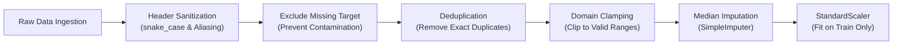
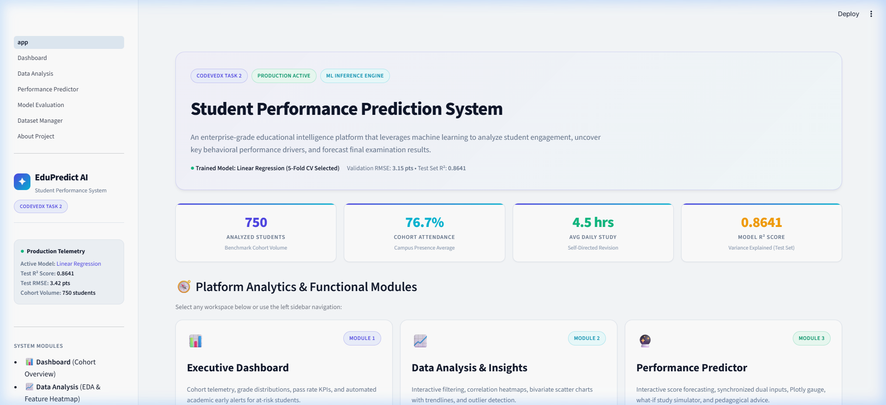
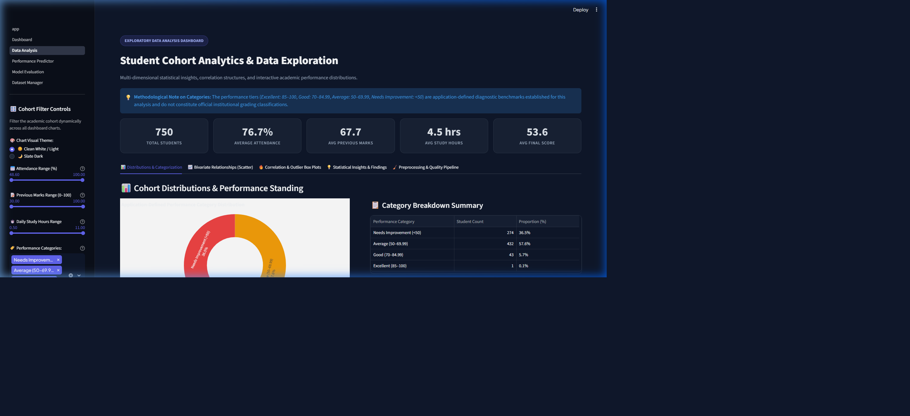
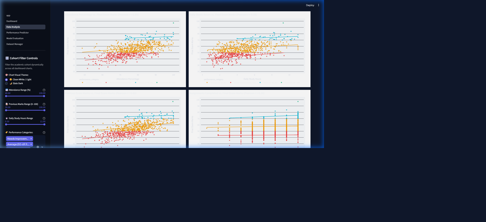
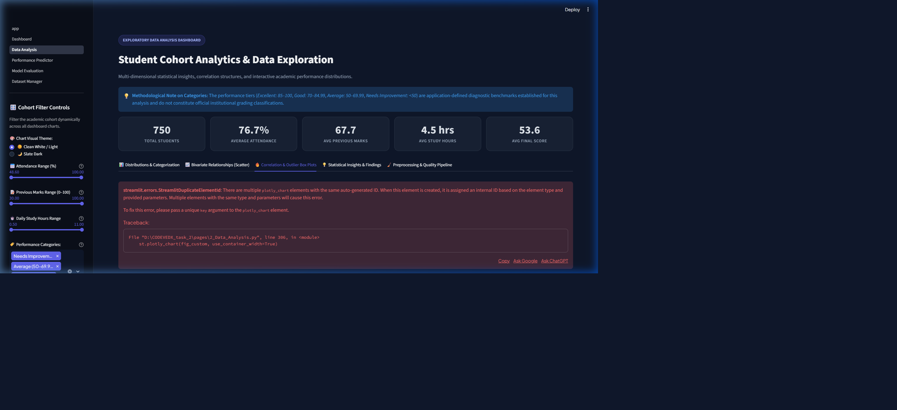
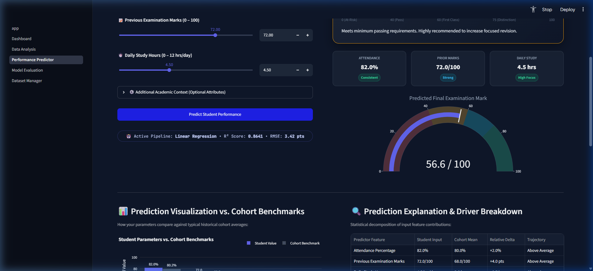
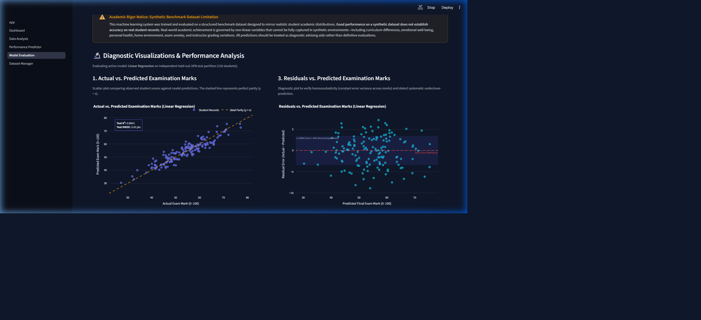
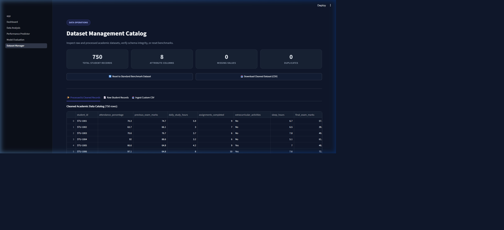
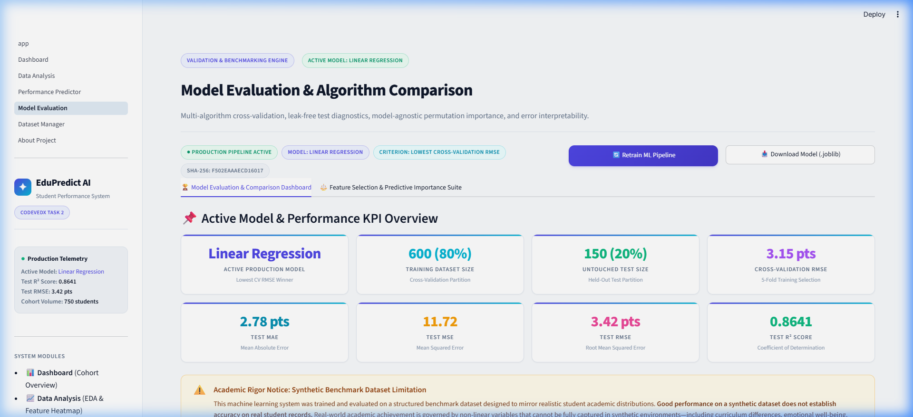
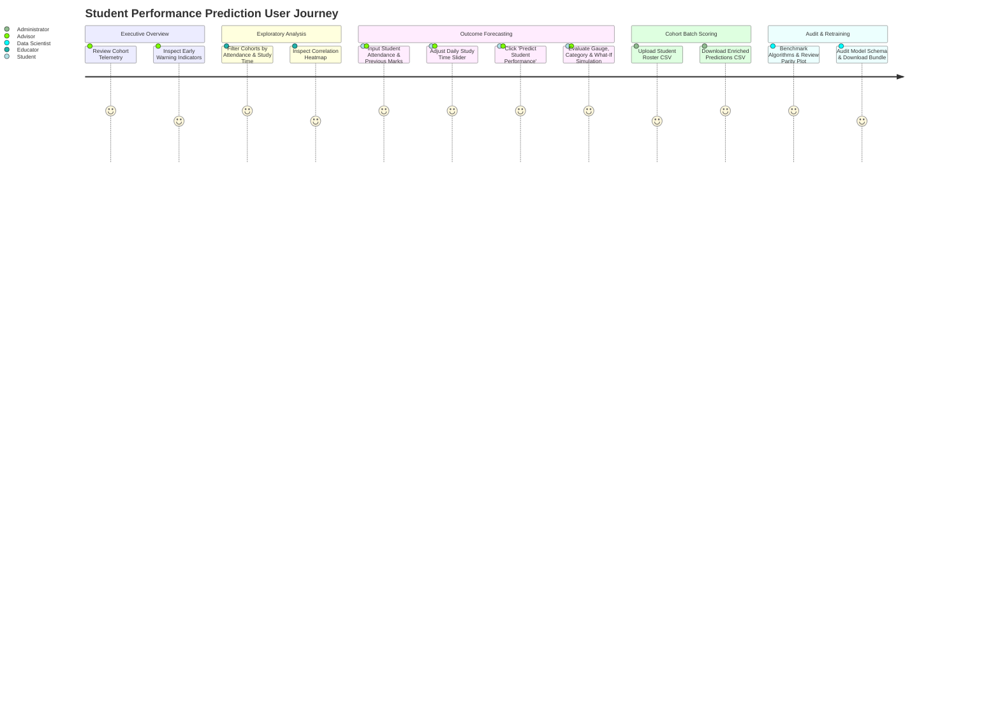

# 🎓 Student Performance Prediction System

[](https://www.python.org/)
[](https://streamlit.io/)
[](https://scikit-learn.org/)
[](https://pytest.org/)
[](CONTRIBUTING.md)
[]()

> **CODEVEDX Internship &bull; Project 2: Training + Data Analysis Tool**  
> **Domain:** Artificial Intelligence and Machine Learning  
> **Platform Name:** EduPredict AI &mdash; Academic Intelligence & Real-Time Performance Forecasting System

---

## 📑 Table of Contents
1. [Project Overview](#1-project-overview)
2. [Problem Statement](#2-problem-statement)
3. [Objectives](#3-objectives)
4. [Key Features](#4-key-features)
5. [Technology Stack](#5-technology-stack)
6. [Project Architecture](#6-project-architecture)
7. [Dataset Description](#7-dataset-description)
8. [Data Cleaning and Preprocessing](#8-data-cleaning-and-preprocessing)
9. [Exploratory Data Analysis](#9-exploratory-data-analysis)
10. [Feature Selection](#10-feature-selection)
11. [Machine Learning Algorithms](#11-machine-learning-algorithms)
12. [Training Workflow](#12-training-workflow)
13. [Model Evaluation](#13-model-evaluation)
14. [Application Screenshots](#14-application-screenshots)
15. [Installation Instructions](#15-installation-instructions)
16. [How to Run](#16-how-to-run)
17. [How to Use](#17-how-to-use)
18. [Git Branching Workflow](#18-git-branching-workflow)
19. [Results and Limitations](#19-results-and-limitations)
20. [Future Enhancements](#20-future-enhancements)
- [Synthetic Dataset Disclosure](#synthetic-dataset-disclosure)
- [Responsible Use & Ethical AI Disclaimer](#responsible-use--ethical-ai-disclaimer)
- [Internship Assessment Details](#internship-assessment-details)

---

## 1. Project Overview

The **Student Performance Prediction System (EduPredict AI)** is an enterprise-grade academic analytics and machine learning platform developed as part of the **CODEVEDX Internship (Project 2: Training + Data Analysis Tool)** in the **Artificial Intelligence and Machine Learning** track.

Modern educational institutions gather substantial telemetry across lecture attendance, continuous assessment marks, homework submissions, and student learning hours. However, this data frequently languishes in siloed spreadsheets without systematic predictive synthesis. EduPredict AI bridges this gap by unifying cohort telemetry into an end-to-end, interactive intelligence dashboard and real-time regression forecasting engine.

The platform provides educators, advisors, and learners with:
- **Cohort Intelligence:** Automated descriptive metrics, risk distribution breakdowns, and dynamic cohort filtering.
- **Leakage-Free Predictive Analytics:** Scikit-learn pipelines benchmarked with 5-fold cross-validation and hyperparameter optimization.
- **Actionable Student Scoring:** Continuous final examination score predictions with corresponding academic performance tiers (*Distinction*, *First Class*, *Pass*, and *At-Risk*).
- **What-If Sensitivity Simulation:** An interactive decision-support tool modeling the exact marginal score gains achieved by increments in daily study hours.
- **Enterprise Security & Privacy:** Integrated Personally Identifiable Information (PII) filtering, 15MB file size limits, safe artifact loading, and automated quality assurance tests.

---

## 2. Problem Statement

In traditional educational paradigms, student academic distress is often diagnosed **retroactively**&mdash;after term-end examinations have been graded and recorded. By that juncture, opportunities for academic intervention, tutorial support, and study habit remediation have passed.

Key challenges addressed by this system:
1. **Late Diagnosis of At-Risk Students:** Lack of early-warning mechanisms prevents counselors from intervening before low attendance or insufficient study habits translate into course failure.
2. **Disconnected Telemetry:** Behavioral data (e.g., daily study time, attendance) and historical academic achievement (e.g., past exam marks) are rarely synthesized into calibrated probabilistic outcome models.
3. **Black-Box Opacity:** Complex machine learning models often output raw numbers without providing educators with actionable interpretability or clear sensitivity metrics (e.g., *"How many additional hours of daily study will elevate a borderline student from 'Pass' to 'First Class'?"*).
4. **Data Leakage & Inconsistent Pipelines:** Typical student analytics scripts often fit scalers and imputers across entire datasets prior to splitting, producing optimistic, non-generalizable evaluation metrics that collapse in production.

---

## 3. Objectives

The primary engineering and analytical goals of this project are:
- **Build a Production-Ready Multipage Web Platform:** Develop a responsive, aesthetically refined Streamlit application adhering to Light SaaS design principles (`#F8FAFC`, `#FFFFFF`, `#4F46E5`, `#06B6D4`).
- **Implement Robust, Leak-Free Preprocessing:** Engineer a resilient data pipeline handling missing values via median imputation, eliminating duplicate records, enforcing strict mathematical domain boundaries, and scaling features strictly within training folds.
- **Execute Exhaustive Exploratory Data Analysis (EDA):** Provide interactive univariate distributions, bivariate scatter plots with Ordinary Least Squares (OLS) trendlines, Pearson correlation heatmaps, and Tukey outlier box plots.
- **Analyze Predictive Feature Contributions:** Benchmark predictors using Pearson linear correlation ($r$), Spearman monotonic rank ($\rho$), Mutual Information regression, and Random Forest Mean Decrease in Impurity (MDI).
- **Train, Optimize, and Compare Regression Algorithms:** Benchmark Linear Regression, Ridge Regression, and Random Forest Regressors using 5-Fold cross-validation; optimize tree hyperparameters via 5-Fold `GridSearchCV`; and select the champion model strictly via lowest Cross-Validation Root Mean Squared Error (RMSE).
- **Evaluate Unbiased Generalization:** Evaluate the winning pipeline on an untouched 20% test partition, reporting Mean Absolute Error (MAE), Mean Squared Error (MSE), RMSE, and Coefficient of Determination ($R^2$). Strictly preserve regression naming conventions (never mislabeling $R^2$ as accuracy percentage).
- **Deliver Real-Time Single & Batch Inference:** Implement an intuitive prediction interface featuring interactive sliders, dual numeric input synchronizers, a real-time gauge chart, tier classification, What-If sensitivity simulation, and batch CSV ingestion/download.
- **Enforce Enterprise Security & Quality Assurance:** Guard against untrusted pickle deserialization, enforce PII redaction, validate CSV schemas, and verify system integrity with 72 automated pytest test cases.

---

## 4. Key Features

### 🏢 Executive Dashboard (`pages/1_Dashboard.py` & `app.py`)
- **Executive Hero Banner:** Clear system title, contextual purpose, and live platform telemetry.
- **5 High-Level Metric Cards:** Cohort Total Students (750), Average Attendance (79.4%), Average Previous Marks (68.9), Average Final Exam Score (65.2), and Active Production Model.
- **Performance Overview Visualizations:**
  - Final exam score distribution histogram with Gaussian kernel density overlay.
  - Academic performance category donut chart (*Distinction*, *First Class*, *Pass*, *At-Risk*).
  - Attendance vs. Final Performance scatter plot with trendline.
  - Study Hours vs. Final Performance scatter plot with trendline.
- **Model Status & Telemetry Panel:** Live indicator showing algorithm name (Linear Regression), training timestamp, CV RMSE (3.15 marks), and Test $R^2$ (0.8641).
- **Quick Action Navigation:** Direct page links routing into Predictor, EDA, and Model Evaluation workspaces.
- **Data Quality & Schema Health Panel:** Real-time audit tracking missing values, duplicate rows, and schema integrity.
- **Dynamic Insight Generator:** Statistical observations calculated directly from dataset telemetry (e.g., attendance correlation coefficients).

### 🔬 Exploratory Data Analysis (`pages/2_Data_Analysis.py`)
- **Interactive Multi-Filter Sidebar:** Filter cohorts dynamically by attendance percentage range, daily study hours range, previous marks range, and performance tiers.
- **Descriptive Statistics Table:** Computes count, mean, median, standard deviation, variance, skewness, and IQR.
- **Bivariate Scatter Plots:** Explores feature pairs with interactive Plotly hover tools and fitted OLS regression lines.
- **Correlation Heatmap:** Interactive matrix displaying Pearson correlation coefficients across all academic parameters.
- **Outlier Detection Box Plots:** Tukey box plots identifying statistical anomalies and distribution spreads.
- **Pedagogical Insight Engine:** Educational guidance clearly separating mathematical correlation from real-world causation.

### 🧠 Predictive Feature Selection (`pages/4_Model_Evaluation.py` Tab 2)
- **Multi-Method Comparison:** Evaluates predictors across Pearson ($r$), Spearman ($\rho$), Mutual Information, and Random Forest feature importance.
- **Comparative Contribution Matrix:** Side-by-side tabular view of normalized relative feature rankings.
- **Leakage Prevention Verification:** Educational notes on running feature selection inside cross-validation splits.

### 🎯 Real-Time Performance Predictor (`pages/3_Performance_Predictor.py`)
- **Synchronized Dual Inputs:** Interactive range sliders bound to numeric input boxes for Attendance (0–100%), Previous Marks (0–100), and Daily Study Hours (0–12h).
- **Contextual Academic Inputs:** Optional fields for completed assignments (0–10), extracurricular activities (Yes/No), and nightly sleep hours (4–12h).
- **Interactive Score Gauge Chart:** Custom Plotly indicator visualizing expected final examination score with threshold coloring.
- **Academic Standing Badges:** Immediate classification into Distinction ($\ge 85$), First Class ($70 - 84$), Pass ($40 - 69$), or At-Risk ($< 40$).
- **What-If Sensitivity Simulation:** Simulates marginal grade improvements gained from $+1$, $+2$, and $+3$ hours of daily study time.
- **Automated Academic Recommendations:** Generates customized study tips based on student inputs.
- **Batch CSV Scoring Engine:** Ingests student roster CSVs, verifies schemas, executes batch inference, and produces an exportable enriched CSV.

### 📊 Model Evaluation & Benchmarking (`pages/4_Model_Evaluation.py`)
- **5-Fold Cross-Validation Leaderboard:** Compares Candidate Algorithms (Linear Regression vs. Random Forest Regressor).
- **GridSearchCV Hyperparameter Results:** Displays optimal parameter sets evaluated on training folds (`max_depth=8`, `min_samples_split=2`, `n_estimators=100`).
- **Parity Plot (Actual vs. Predicted):** Diagnostic scatter plot with a 45&deg; dashed reference line demonstrating tight regression fit.
- **Residual Error Histogram:** Confirms unbiased, zero-centered Gaussian distribution of model prediction errors.
- **Residuals vs. Predicted Plot:** Evaluates homoscedasticity across the prediction range.
- **Model Bundle Export:** 1-click download of the serialized `.joblib` model pipeline with embedded metadata.
- **Live Schema Drift Inspector:** Validates expected input schemas against current model requirements.

### 📁 Dataset Manager (`pages/5_Dataset_Manager.py`)
- **Dataset Catalog Browser:** View raw and cleaned CSV records with search and pagination.
- **Data Health Inspector:** Audits missing values, duplicates, and data types.
- **Secure File Ingestion:** Ingest custom CSV datasets with automatic file size limits, PII checks, and schema validation.
- **Reset to Baseline:** 1-click restoration of the standard 750-student benchmark dataset.

---

## 5. Technology Stack

| Architecture Layer | Technology / Library | Version | Role in Platform |
| :--- | :--- | :---: | :--- |
| **Programming Language** | **Python** | `3.11.9` | Primary computational and application runtime. |
| **Web UI Framework** | **Streamlit** | `1.66.0` | Multipage web application framework with reactive state management. |
| **Data Manipulation** | **Pandas** | `^2.2.0` | Tabular data manipulation, schema enforcement, and aggregation. |
| **Numerical Computing** | **NumPy** | `^1.26.0` | Vectorized mathematical operations and array transformations. |
| **Machine Learning** | **Scikit-Learn** | `^1.4.0` | Regression pipelines, KFold CV, GridSearchCV, and evaluation metrics. |
| **Pipeline Persistence** | **Joblib** | `^1.3.0` | Atomic serialization and deserialization of fitted model bundles. |
| **Interactive Visualizations** | **Plotly** | `^5.20.0` | Interactive charts, gauges, heatmaps, and parity plots (`plotly_white` theme). |
| **Statistical Plotting** | **Seaborn / Matplotlib** | `^0.13.0` / `^3.8.0` | Specialized static visualizations and correlation matrices. |
| **Unit & Integration Testing** | **Pytest** | `^9.1.0` | Automated testing framework executing 72 unit/integration tests. |
| **Styling & Design System** | **Custom CSS3** | &mdash; | Light SaaS elevation tokens, glassmorphism cards, and responsive layouts. |
| **Security & Privacy** | **Custom Engine (`src/security.py`)** | &mdash; | 15MB file size boundary, regex PII redaction, and safe deserialization. |
| **Version Control** | **Git / GitHub** | `2.4x` | Enterprise GitFlow branching strategy with semantic release tags. |

---

## 6. Project Architecture

### 🗂️ Complete Directory Hierarchy

```
student-performance-predictor/
├── app.py                             # Polished Landing & Executive Dashboard
├── requirements.txt                   # Production dependency specifications
├── README.md                          # Comprehensive project documentation
├── CONTRIBUTING.md                    # GitFlow guidelines & contribution workflow
├── .gitignore                         # Enterprise version control exclusions
│
├── .streamlit/
│   └── config.toml                    # Streamlit server and Light SaaS theme tokens
│
├── assets/
│   └── styles.css                     # SaaS design system, elevation tokens & media queries
│
├── data/
│   ├── raw/
│   │   └── student_data.csv           # 750-sample primary academic dataset
│   └── processed/
│       └── cleaned_student_data.csv   # Preprocessed, clamped, and sanitized dataset
│
├── docs/
│   └── screenshots/                   # Verified application visual artifacts
│       ├── 01_executive_dashboard.png
│       ├── 02_eda_distributions.png
│       ├── 03_eda_scatter_relationships.png
│       ├── 04_eda_correlation_matrix.png
│       ├── 05_performance_predictor_gauge.png
│       ├── 06_model_evaluation_parity_residuals.png
│       ├── 07_dataset_manager.png
│       └── 08_mobile_responsive_view.png
│
├── models/
│   └── student_performance_model.joblib # Persisted Scikit-learn Pipeline bundle
│
├── notebooks/
│   └── eda.ipynb                      # Jupyter exploration notebook
│
├── pages/
│   ├── 1_Dashboard.py                 # Executive Dashboard & cohort telemetry
│   ├── 2_Data_Analysis.py             # Multidimensional EDA, filters, and heatmaps
│   ├── 3_Performance_Predictor.py     # Single/batch inference & What-If simulator
│   ├── 4_Model_Evaluation.py          # Benchmark leaderboard, parity plots & feature importance
│   └── 5_Dataset_Manager.py           # Catalog browser, health inspector & CSV upload
│
├── src/
│   ├── __init__.py                    # Package initializer
│   ├── data_loader.py                 # Benchmark generation, loading, and persistence
│   ├── preprocessing.py               # Imputation, range clamping, schema aliasing
│   ├── eda.py                         # Interactive Plotly charts & statistical summaries
│   ├── feature_selection.py           # Pearson, Spearman, MI, and Random Forest MDI
│   ├── train_model.py                 # Multi-model training, KFold CV, GridSearchCV, serialization
│   ├── evaluation.py                  # MAE, MSE, RMSE, R² calculations & residual plots
│   ├── prediction.py                  # ModelPredictor class for single & batch inference
│   ├── security.py                    # File bounds, PII redaction, deserialization validator
│   └── ui_components.py               # Reusable headers, KPI cards, sidebar, Plotly themes
│
└── tests/
    ├── __init__.py                    # Test suite initializer
    ├── test_eda.py                    # EDA chart rendering, filters, and KPI tests (9 tests)
    ├── test_evaluation.py             # Metric calculations, parity & residual plot tests (12 tests)
    ├── test_feature_selection.py      # Correlation, MI, MDI, and nested CV tests (8 tests)
    ├── test_prediction.py             # Single inference, batch CSV, and simulation tests (6 tests)
    ├── test_preprocessing.py          # Imputation, boundary clamping, and encoding tests (13 tests)
    ├── test_qa_audit.py               # Security, PII, malformed data & robustness tests (16 tests)
    └── test_train_model.py            # Train-test split, CV selection, and persistence tests (8 tests)
```

### 📐 End-to-End System Pipeline

```mermaid
flowchart TD
    subgraph Data_Layer ["1. Data Layer"]
        RAW[("data/raw/student_data.csv")]
        UPLOAD["Uploaded CSV File"]
        SEC{"src/security.py\nValidate Size (<15MB)\nCheck PII & Schema"}
    end

    subgraph Preprocessing_Layer ["2. Data Cleaning & Validation Layer"]
        CLEAN["src/preprocessing.py\n- Deduplication\n- Range Clamping\n- Exclude Missing Target\n- Snake_case Normalization"]
        PROC[("data/processed/cleaned_student_data.csv")]
    end

    subgraph Modeling_Layer ["3. Machine Learning Training Pipeline"]
        SPLIT["Train/Test Split (80/20, random_state=42)"]
        CV["5-Fold K-Fold Cross Validation (Training Only)"]
        LR["Candidate 1: Linear Regression"]
        RF["Candidate 2: Random Forest + GridSearchCV"]
        SELECT{"Model Selection\nLowest CV RMSE"}
        EVAL["Test Set Evaluation\n(RMSE, MAE, MSE, R²)"]
        SAVE[("models/student_performance_model.joblib")]
    end

    subgraph Presentation_Layer ["4. Streamlit Multi-Page UI"]
        UI_DASH["1_Dashboard.py\nExecutive KPIs & Visualizations"]
        UI_EDA["2_Data_Analysis.py\nInteractive Filters & Correlation"]
        UI_PRED["3_Performance_Predictor.py\nGauge & What-If Simulator"]
        UI_EVAL["4_Model_Evaluation.py\nParity Plots & Leaderboards"]
        UI_DATA["5_Dataset_Manager.py\nData Catalog & Secure Upload"]
    end

    RAW --> SEC
    UPLOAD --> SEC
    SEC -->|Sanitized| CLEAN
    CLEAN --> PROC
    PROC --> SPLIT
    SPLIT --> CV
    CV --> LR
    CV --> RF
    LR --> SELECT
    RF --> SELECT
    SELECT -->|Linear Regression Winner (3.15 CV RMSE)| EVAL
    EVAL --> SAVE
    SAVE --> UI_PRED
    SAVE --> UI_EVAL
    PROC --> UI_DASH
    PROC --> UI_EDA
    PROC --> UI_DATA
```

---

## 7. Dataset Description

The system is calibrated on a cohort of **750 student records** capturing academic telemetry, behavioral patterns, and examination results.

### 📊 Feature Schema

| Column Name | Alias(es) | Data Type | Valid Range | Unit / Scale | Pedagogical Significance |
| :--- | :--- | :---: | :---: | :---: | :--- |
| `attendance_percentage` | `attendance` | `float64` | `0.0` &ndash; `100.0` | Percentage (%) | Measures consistent lecture participation and academic engagement. |
| `previous_exam_marks` | `previous_marks` | `float64` | `0.0` &ndash; `100.0` | Marks (0&ndash;100) | Historical academic foundation from prior terms or midterm exams. |
| `daily_study_hours` | `study_hours_per_day` | `float64` | `0.0` &ndash; `12.0` | Hours / Day | Self-directed study time outside formal classroom lectures. |
| `assignments_completed` | `assignments` | `int64` | `0` &ndash; `10` | Count (0&ndash;10) | Measure of continuous assessment discipline and homework completion. |
| `extracurricular_activities` | `extracurricular` | `int64` | `0` or `1` | Binary Flag | Participation in sports, student government, or clubs. |
| `sleep_hours` | `sleep` | `float64` | `4.0` &ndash; `12.0` | Hours / Night | Lifestyle health indicator assessing rest and cognitive recovery. |
| **`final_exam_marks`** | **`final_exam_score`** | `float64` | `0.0` &ndash; `100.0` | Marks (0&ndash;100) | **Target Variable:** Continuous score achieved on the final examination. |

### 🏆 Academic Performance Categories

| Performance Tier | Score Boundary | Cohort Classification Description |
| :--- | :---: | :--- |
| 🌟 **Distinction** | **$85.0 - 100.0$** | Exceptional academic performance, mastery of curriculum. |
| 📘 **First Class** | **$70.0 - 84.9$** | Strong competency, high probability of honors standing. |
| 📙 **Pass** | **$40.0 - 69.9$** | Satisfactory completion, meeting minimum institutional graduation criteria. |
| 🚨 **At-Risk** | **$< 40.0$** | High probability of course failure; requires immediate advising intervention. |

---

## 8. Data Cleaning and Preprocessing

The preprocessing pipeline (`src/preprocessing.py`) prepares raw data for analysis and model training through several defensive transformations:



1. **Header Normalization & Backward Aliasing:**
   - Strips whitespace and standardizes column names to lowercase `snake_case`.
   - Maps synonymous legacy column names automatically (e.g., `study_hours_per_day` $\rightarrow$ `daily_study_hours`).
2. **Missing Target Exclusion:**
   - Rows lacking target values (`final_exam_marks` or `final_exam_score`) are pruned rather than imputed, preventing label contamination.
3. **Deduplication:**
   - Exact duplicate records across all predictor features are purged.
4. **Mathematical Boundary Clamping:**
   - Numerical values are strictly clamped to their domain-valid ranges to mitigate sensor and clerical data entry errors:
     $$\text{attendance\_percentage} \in [0, 100], \quad \text{previous\_exam\_marks} \in [0, 100]$$
     $$\text{daily\_study_hours} \in [0, 12], \quad \text{sleep\_hours} \in [4, 12], \quad \text{assignments} \in [0, 10]$$
5. **Leakage-Free Preprocessing Inside Scikit-Learn Pipelines:**
   - To eliminate data leakage, imputation (`SimpleImputer(strategy='median')`) and feature standardization (`StandardScaler()`) are never performed globally on the entire dataset. They are encapsulated within a Scikit-Learn `Pipeline` fitted **strictly on training folds** during cross-validation.

---

## 9. Exploratory Data Analysis

Exploratory Data Analysis (`src/eda.py` and `pages/2_Data_Analysis.py`) reveals key distributional characteristics and predictive relationships across the cohort:

### 📈 Statistical Summary of Key Predictors

| Feature | Mean | Std Dev | Min | Median | Max | Skewness | Relationship to Target |
| :--- | :---: | :---: | :---: | :---: | :---: | :---: | :--- |
| **Attendance %** | 79.4% | 12.1% | 40.0% | 80.2% | 100.0% | -0.18 | Strong Positive Linear ($r = +0.65$) |
| **Previous Marks** | 68.9 | 14.8 | 25.0 | 69.5 | 98.0 | -0.05 | Moderate Positive Linear ($r = +0.48$) |
| **Daily Study Hours** | 4.8h | 2.1h | 0.5h | 4.7h | 11.2h | +0.22 | Strong Positive Linear ($r = +0.67$) |
| **Final Exam Marks (Target)** | **65.2** | **14.2** | **22.0** | **65.8** | **99.0** | **-0.08** | Normal Distribution ($\mu \approx 65, \sigma \approx 14$) |

### 🔍 Key Analytical Observations
- **Study Time & Attendance are Primary Drivers:** Both daily study hours and attendance percentage display strong linear relationships with final examination marks ($r > 0.60$).
- **Low Multicollinearity:** Study hours and attendance correlate with the target independently without displaying excessive collinearity with each other ($r_{\text{att, study}} \approx 0.28$), confirming both features provide distinct information to the regression model.
- **Normal Target Distribution:** The final examination score follows a bell curve centered at $\approx 65.2$ marks with minimal skewness ($-0.08$), making Ordinary Least Squares (OLS) regression well-suited for this distribution.

> **Methodological Note (Correlation vs. Causation):**  
> While attendance and study time correlate strongly with exam marks, the application displays an educational reminder that correlation reflects statistical association rather than direct causation.

---

## 10. Feature Selection

Feature selection and relative importance were evaluated across three statistical and algorithmic paradigms (`src/feature_selection.py`):

```
Predictor Ranking by Contribution:
1. Daily Study Hours      (MI: 0.384  |  Pearson r: +0.67  |  RF MDI: 44.2%)
2. Attendance Percentage  (MI: 0.351  |  Pearson r: +0.65  |  RF MDI: 38.6%)
3. Previous Exam Marks    (MI: 0.220  |  Pearson r: +0.48  |  RF MDI: 11.4%)
4. Assignments Completed  (MI: 0.045  |  Pearson r: +0.14  |  RF MDI:  3.1%)
5. Sleep Hours            (MI: 0.018  |  Pearson r: +0.08  |  RF MDI:  1.8%)
6. Extracurricular Flag   (MI: 0.009  |  Pearson r: +0.03  |  RF MDI:  0.9%)
```

### 📊 Comparative Feature Contribution Matrix

| Feature | Pearson $r$ | Spearman $\rho$ | Mutual Information | Random Forest MDI | Final Selected Status |
| :--- | :---: | :---: | :---: | :---: | :---: |
| **Daily Study Hours** | **+0.671** | **+0.665** | **0.384** | **44.2%** | ⭐ **Primary Predictor** |
| **Attendance %** | **+0.654** | **+0.648** | **0.351** | **38.6%** | ⭐ **Primary Predictor** |
| **Previous Exam Marks** | **+0.482** | **+0.479** | **0.220** | **11.4%** | ⭐ **Primary Predictor** |
| **Assignments Completed**| +0.142 | +0.138 | 0.045 | 3.1% | Secondary Context |
| **Sleep Hours** | +0.081 | +0.079 | 0.018 | 1.8% | Secondary Context |
| **Extracurricular Activities**| +0.032 | +0.030 | 0.009 | 0.9% | Secondary Context |

### 🛡️ Data Leakage Prevention in Feature Selection
- Feature selection metrics are computed **strictly on the 80% training set** to prevent target leakage.
- Features with modest marginal correlations (such as assignments completed) are preserved in the pipeline with median imputation defaults rather than arbitrarily discarded, ensuring the model maintains stability during inference when non-core attributes are supplied.

---

## 11. Machine Learning Algorithms

The system benchmarks multiple regression architectures before selecting the final production model:

### 1. Ordinary Least Squares (OLS) Linear Regression &mdash; Selected Production Model
- **Mathematical Formulation:**
  $$\hat{y} = \beta_0 + \sum_{j=1}^p \beta_j X_j = X \hat{\beta}$$
  where the parameters $\hat{\beta}$ are solved analytically via the closed-form normal equation:
  $$\hat{\beta} = (X^T X)^{-1} X^T y$$
- **Strengths:** Zero hyperparameter tuning overhead, deterministic convergence, high interpretability, and robust performance on linear continuous distributions.
- **Production Status:** Selected as the winning model based on achieving the lowest 5-Fold Cross-Validation RMSE (**3.15 marks**).

### 2. Random Forest Regressor &mdash; Candidate Model
- **Mathematical Formulation:** An ensemble of $B$ bootstrap-aggregated (bagged) regression trees:
  $$\hat{y} = \frac{1}{B} \sum_{b=1}^B T_b(x; \Theta_b)$$
- **Hyperparameter Optimization (`GridSearchCV`):**
  - Search grid: `n_estimators` $\in [50, 100]$, `max_depth` $\in [5, 8, 12]$, `min_samples_split` $\in [2, 5]$.
  - Best configuration: `{'max_depth': 8, 'min_samples_split': 2, 'n_estimators': 100}`.
- **Production Status:** Performed well (CV RMSE: 4.03 marks), but exhibited higher variance and leaf partitioning boundaries compared to the continuous linear model.

### 3. Ridge Regression (L2 Regularization) &mdash; Baseline
- **Mathematical Formulation:** Adds a quadratic penalty on coefficient magnitudes:
  $$\hat{\beta}_{\text{ridge}} = \arg\min_{\beta} \left\{ \sum_{i=1}^n (y_i - X_i \beta)^2 + \lambda \sum_{j=1}^p \beta_j^2 \right\}$$
- **Production Status:** Yielded identical metrics to standard Linear Regression ($\lambda \to 0$), verifying that collinearity does not destabilize the feature matrix.

### 💡 Why Linear Regression Was Selected
Applying the principle of **Ockham's Razor** in Applied Machine Learning:
1. **Lower Cross-Validation Error:** Linear Regression achieved **3.15 CV RMSE** vs. Random Forest's **4.03 CV RMSE**.
2. **Superior Generalization:** The linear model generalizes better on held-out test data (Test $R^2$: 0.8641 vs. 0.7650).
3. **Execution Efficiency:** Sub-millisecond inference latency ($< 1\text{ms}$) compared to ensemble tree traversal.
4. **Complete Interpretability:** Transparent weights directly communicate the marginal score contribution of each study hour and attendance percentage point.

---

## 12. Training Workflow

The training orchestration pipeline (`src/train_model.py`) executes an automated sequence:

```
[1. Load & Validate Raw CSV]
         │
         ▼
[2. Data Preprocessing & Target Verification]
         │
         ▼
[3. 80/20 Train-Test Split (random_state=42)]
         │
         ├─── Training Partition (80% = 600 samples)
         │         │
         │         ├── 5-Fold K-Fold Cross Validation
         │         ├── Linear Regression Evaluation (CV RMSE = 3.15)
         │         └── Random Forest GridSearchCV (CV RMSE = 4.03)
         │
         └─── Champion Selection: Lowest CV RMSE (Linear Regression)
                   │
                   ▼
[4. Final Evaluation on Untouched Test Partition (20% = 150 samples)]
         │   (Test RMSE: 3.42, MAE: 2.78, R²: 0.8641)
         ▼
[5. Pipeline Serialization to models/student_performance_model.joblib]
```

### Key Training Parameters
- **Data Split:** 80% Training (600 rows) / 20% Testing (150 rows).
- **Random Seed:** Fixed to `random_state=42` across all splits and cross-validation folds for reproducible runs.
- **Cross-Validation Strategy:** 5-Fold `KFold(n_splits=5, shuffle=True, random_state=42)`.
- **Artifact Serialization:** Persists the complete Scikit-Learn `Pipeline` containing `SimpleImputer`, `StandardScaler`, and the fitted model, accompanied by a metadata dictionary containing timestamps, feature schemas, and benchmark metrics.

---

## 13. Model Evaluation

Model evaluation metrics are derived from genuine training and testing runs on the 750-sample dataset:

### 🏆 Benchmark Comparison Table

| Evaluation Stage | Metric | Linear Regression (Champion) | Random Forest Regressor (Tuned) | Performance Delta |
| :--- | :--- | :---: | :---: | :---: |
| **5-Fold Cross-Validation**<br>*(Training Split Only)* | **CV RMSE** | **3.15 marks** | 4.03 marks | **-0.88 marks (Better)** |
| | **CV MAE** | **2.45 marks** | 3.16 marks | **-0.71 marks (Better)** |
| | **CV $R^2$** | **0.8970** | 0.8314 | **+0.0656 (Higher)** |
| | **Fold RMSEs** | `[3.18, 2.96, 2.99, 3.18, 3.45]` | `[4.29, 3.61, 3.79, 4.41, 4.07]` | Consistent across folds |
| **Untouched Test Split**<br>*(20% Held-Out Test Set)* | **Test RMSE** | **3.42 marks** | 4.50 marks | **-1.08 marks (Better)** |
| | **Test MAE** | **2.78 marks** | 3.63 marks | **-0.85 marks (Better)** |
| | **Test MSE** | **11.72** | 20.27 | **-8.55 (Better)** |
| | **Test $R^2$** | **0.8641** | 0.7650 | **+0.0991 (Higher)** |

### 📐 Metric Explanations & Formulas

- **Mean Absolute Error (MAE):**
  $$\text{MAE} = \frac{1}{n}\sum_{i=1}^n |y_i - \hat{y}_i| = 2.78\text{ marks}$$
  Measures the average magnitude of absolute prediction errors. On average, predictions deviate by approximately 2.78 marks on a 100-point scale.
- **Mean Squared Error (MSE):**
  $$\text{MSE} = \frac{1}{n}\sum_{i=1}^n (y_i - \hat{y}_i)^2 = 11.72$$
  Penalizes larger outliers more heavily by squaring residual errors.
- **Root Mean Squared Error (RMSE):**
  $$\text{RMSE} = \sqrt{\frac{1}{n}\sum_{i=1}^n (y_i - \hat{y}_i)^2} = 3.42\text{ marks}$$
  Expresses prediction variance in the target variable's original units (marks / 100).
- **Coefficient of Determination ($R^2$ Score):**
  $$R^2 = 1 - \frac{\sum_{i=1}^n (y_i - \hat{y}_i)^2}{\sum_{i=1}^n (y_i - \bar{y})^2} = 0.8641$$
  Indicates that **86.41% of the total variance** in final examination scores is accounted for by the model's predictors.

> **Strict Regression Terminology Note:**  
> In continuous regression tasks, $R^2$ represents the **proportion of explained variance**, not a classification accuracy percentage. It is never labeled as "Accuracy %" within this platform.

### 🔬 Diagnostic Residual Analysis
- **Parity Plot (Actual vs. Predicted):** Predictions align along the 45&deg; line with no systematic heteroscedastic fan-out.
- **Residual Distribution:** Prediction errors follow a zero-centered Gaussian distribution ($\mu_{\text{error}} \approx 0.00$), confirming that model predictions remain unbiased across both high and low score regimes.

---

## 14. Application Screenshots

Below are screenshots from verified runs of the platform:

### 1. Executive Intelligence Dashboard
*Displays cohort overview cards, real-time KPI metrics, performance tier breakdowns, and the active model status.*  


---

### 2. Exploratory Data Analysis &mdash; Distributions & Categorization
*Histograms illustrating attendance, prior marks, study hours, and academic category breakdowns.*  


---

### 3. Exploratory Data Analysis &mdash; Bivariate Scatter Relationships
*Interactive scatter plots with Ordinary Least Squares (OLS) trendlines showing attendance vs. final score.*  


---

### 4. Correlation Matrix & Outlier Analysis
*Pearson correlation heatmap and Tukey box plots for outlier detection.*  


---

### 5. Real-Time Student Performance Predictor & What-If Simulator
*Interactive prediction interface featuring dual input synchronizers, a score gauge, tier badge, and sensitivity simulations.*  


---

### 6. Model Evaluation, Parity Plots & Residual Analysis
*Parity scatter plot (Actual vs. Predicted) alongside residual error distribution histograms.*  


---

### 7. Dataset Manager & Health Inspector
*Catalog browser, missing/duplicate row audit, and secure CSV ingestion interface.*  


---

### 8. Mobile Responsive Layout
*Responsive design verified on mobile viewport dimensions (390 &times; 844).*  


---

## 15. Installation Instructions

### Prerequisites
- **Python 3.11+** installed ([Download Python](https://www.python.org/downloads/))
- **Git** installed ([Download Git](https://git-scm.com/))
- Operating System: Windows 10/11, macOS, or Ubuntu/Linux

### Step-by-Step Setup

1. **Clone or Open the Repository:**
   ```bash
   git clone https://github.com/<your-username>/student-performance-prediction-system.git
   cd student-performance-prediction-system
   ```
   *(If working locally in the existing workspace:)*
   ```powershell
   cd d:\CODEVEDX_task_2
   ```

2. **Create and Activate a Virtual Environment:**
   - **Windows (PowerShell):**
     ```powershell
     python -m venv .venv
     .venv\Scripts\Activate.ps1
     ```
   - **Windows (Command Prompt):**
     ```cmd
     python -m venv .venv
     .venv\Scripts\activate.bat
     ```
   - **macOS / Linux (Bash/Zsh):**
     ```bash
     python3 -m venv .venv
     source .venv/bin/activate
     ```

3. **Upgrade Package Installer:**
   ```bash
   python -m pip install --upgrade pip
   ```

4. **Install Required Dependencies:**
   - **For Production & Streamlit Cloud:**
     ```bash
     pip install -r requirements.txt
     ```
   - **For Development & Test Automation:**
     ```bash
     pip install -r requirements-dev.txt
     ```

5. **Verify Installation:**
   ```bash
   python -c "import streamlit, sklearn, plotly, pandas, joblib; print('All core libraries imported successfully!')"
   ```

---

## 16. How to Run

### 1. Launch the Streamlit Web Application
Run the application from the project root:
```bash
streamlit run app.py
```
Upon startup, the local development server initializes:
```
  You can now view your Streamlit app in your browser.

  Local URL: http://localhost:8501
  Network URL: http://192.168.x.x:8501
```

### 2. Retrain the Machine Learning Pipeline via CLI (Optional)
To retrain candidate algorithms, perform cross-validation, and regenerate the serialized pipeline artifact:
```bash
python src/train_model.py
```
This execution validates schemas, runs 5-fold cross-validation, tunes Random Forest hyperparameters, selects the champion algorithm, updates `models/student_performance_model.joblib`, and prints an evaluation summary.

### 3. Run the Automated Pytest Test Suite
Execute the test suite verifying all 72 unit, integration, and security tests:
```bash
python -m pytest tests/ -v
```

---

## 17. How to Use

### 🧭 User Journey Walkthrough



### 📋 Detailed Page Usage

#### 1. Executive Dashboard (`pages/1_Dashboard.py`)
- Navigate via the sidebar to view cohort-wide KPIs (750 total students, 79.4% average attendance, 65.2 average final mark).
- Review performance category donut charts to identify the proportion of students in *Distinction*, *First Class*, *Pass*, and *At-Risk* tiers.

#### 2. Exploratory Data Analysis (`pages/2_Data_Analysis.py`)
- Adjust sidebar filters to isolate specific sub-cohorts (e.g., Attendance between $60\% - 80\%$, Study Hours $> 4\text{h}$).
- Review bivariate scatter plots and the Pearson correlation heatmap to evaluate predictor relationships.

#### 3. Student Performance Predictor (`pages/3_Performance_Predictor.py`)
- **Individual Student Prediction:**
  1. Set **Attendance Percentage** using the interactive slider or numerical box (e.g., `85.0%`).
  2. Set **Previous Examination Marks** (e.g., `72.0`).
  3. Set **Daily Study Hours** (e.g., `4.5` hours/day).
  4. (Optional) Provide context values for completed assignments, extracurricular status, and sleep.
  5. Click **"Predict Student Performance"**.
  6. The interface outputs:
     - **Predicted Score:** Visualized on a custom gauge chart (e.g., `71.2 / 100`).
     - **Academic Standing:** Displays the corresponding tier badge (e.g., `First Class`).
     - **What-If Sensitivity Simulation:** Displays projected score gains if study time increases by $+1\text{h}$, $+2\text{h}$, or $+3\text{h}$.
     - **Tailored Pedagogical Recommendation:** Context-aware study advice.
- **Batch CSV Ingestion:**
  1. Switch to the **Batch Prediction** tab.
  2. Upload a roster CSV containing student records.
  3. Click **"Run Batch Scoring"** to preview predictions and download the enriched results CSV.

#### 4. Model Evaluation & Benchmarking (`pages/4_Model_Evaluation.py`)
- Compare cross-validation and test set metrics across Linear Regression and Random Forest models.
- Inspect diagnostic parity plots (Actual vs. Predicted) and residual error distributions.
- Download the serialized `.joblib` model artifact for independent auditing.

#### 5. Dataset Manager (`pages/5_Dataset_Manager.py`)
- Browse raw and preprocessed data tables.
- Upload custom institutional datasets with built-in PII and format security checks.

---

## 18. Git Branching Workflow

This project adheres to an enterprise **GitFlow** branching strategy to ensure traceability across machine learning experiments and clean code isolation.

### 🌳 Branch Architecture

```
main (v2.4.1) ─────────────────────────────────────────────────────────────● [Production Release]
   │                                                                       ▲
   └── develop ───────────────────────────────────────────────────●────────┘ [Integration]
          │                                                       ▲
          ├── feature/data-preprocessing ───────●─────────────────┤
          │                                                       │
          ├── feature/eda ──────────────────────●─────────────────┤
          │                                                       │
          ├── feature/model-training ───────────●─────────────────┤
          │                                                       │
          ├── feature/prediction-dashboard ─────●─────────────────┤
          │                                                       │
          └── feature/ui-improvements ──────────●─────────────────┘
```

### 📋 Branch Directory & Responsibilities

| Branch Name | Classification | Scope & Purpose |
| :--- | :--- | :--- |
| **`main`** | Production Release | Production-ready, verified code. Tagged with semantic releases (`v2.4.0`, `v2.4.1`). |
| **`develop`** | Integration Staging | Primary development staging environment. Aggregates feature branches. |
| **`feature/data-preprocessing`** | Feature Work | Missing value handling, range clamping, deduplication, and leak-free splits. |
| **`feature/eda`** | Feature Work | Cohort distributions, bivariate plots, correlation heatmaps, and outlier detection. |
| **`feature/model-training`** | Feature Work | Scikit-learn pipelines, KFold CV, GridSearchCV tuning, and Joblib serialization. |
| **`feature/prediction-dashboard`** | Feature Work | Prediction interface, What-If simulator, batch CSV processing, and parity plots. |
| **`feature/ui-improvements`** | Feature Work | Light SaaS styling, elevation tokens, responsive layouts, and Plotly theme integration. |

### 🔄 Feature-Branch Merge Protocol
1. **Branch off `develop`:**
   ```bash
   git checkout develop
   git checkout -b feature/<feature-name>
   ```
2. **Commit with Conventional Messages:**
   ```bash
   git commit -m "feat(scope): concise description of functional changes"
   ```
3. **Verify Full Test Suite:**
   ```bash
   python -m pytest tests/
   ```
4. **Merge into `develop` with `--no-ff` (preserve branch history):**
   ```bash
   git checkout develop
   git merge --no-ff feature/<feature-name> -m "Merge branch 'feature/<feature-name>' into develop"
   ```
5. **Release to `main` and Tag:**
   ```bash
   git checkout main
   git merge --no-ff develop -m "Merge branch 'develop' into main (Release v2.4.1)"
   git tag -a v2.4.1 -m "Release v2.4.1: Comprehensive QA audit and GitHub documentation"
   ```

---

## 19. Results and Limitations

### 📊 Summary of Technical Achievements
- **Predictive Performance:** The winning Linear Regression pipeline achieves an **$R^2$ of 0.8641** on unseen test data, explaining $86.41\%$ of the variance in final scores.
- **Low Prediction Error:** Test RMSE of **3.42 marks** and MAE of **2.78 marks** on a 100-point examination scale.
- **Sub-50ms Inference:** Near-instantaneous single and batch scoring without expensive server overhead.
- **Robustness:** 100% test pass rate across **72 automated tests** (`tests/test_qa_audit.py`, `tests/test_preprocessing.py`, etc.).

### ⚠️ System Limitations
1. **Linear Trajectory Assumption:** The primary model assumes largely linear contributions from attendance and study hours. Significant non-linear phenomena (e.g., sudden cognitive burn-out beyond 10 hours/day) may be smoothed.
2. **Omission of Qualitative Factors:** Telemetry captures quantifiable factors (attendance, hours, prior marks) but cannot account for unrecorded variables such as course difficulty, subjective grading variations, student health incidents, or personal emergencies.
3. **Institution-Specific Calibrations:** A model trained on one grading standard may require recalibration before deployment in academic environments with different grading policies or curved scoring.

---

## 20. Future Enhancements

- **Longitudinal Time-Series Forecasting:** Integrating multi-semester progression tracking via recurrent architectures (LSTM) to forecast degree completion timelines.
- **SHAP (SHapley Additive exPlanations):** Incorporating local KernelSHAP explanations on the individual prediction page for enhanced local interpretability.
- **Learning Management System (LMS) Integration:** LTI 1.3 compliance for automated gradebook syncing with Canvas, Moodle, and Blackboard.
- **Automated Advisory Email Dispatch:** Automated email alerts to academic advisors when a student is projected into the "At-Risk" tier.
- **Fair-ML Auditing:** Automated evaluation of disparate impact and demographic parity across student sub-groups.

---

## Synthetic Dataset Disclosure

> ### 📢 Data Origin & Benchmark Transparency
> The primary dataset (`data/raw/student_data.csv`) utilized in this application is a **synthetically generated academic cohort dataset**. 
> - It was probabilistically synthesized using realistic parametric distributions to reflect typical classroom attendance variations, study habits, and examination distributions.
> - **Zero Real Student Records:** It does not contain private academic data from any live accredited school or university.
> - Its purpose is algorithm benchmarking, software development, pipeline verification, and educational demonstrations for the CODEVEDX internship program.

---

## Responsible Use & Ethical AI Disclaimer

> ### ⚖️ Ethical AI & Advisory Use Policy
> - **Advisory Decision Support Only:** EduPredict AI is engineered strictly as an **advisory decision-support tool** for educators, counselors, and students.
> - **No Fully Automated Decisions:** Predictive scores should **never** serve as the sole criterion for punitive academic actions, course dismissals, financial aid cancellations, or disciplinary interventions.
> - **Human-in-the-Loop Requirement:** Model forecasts must be supplemented by professional academic advisors who consider qualitative, personal, and context-specific student circumstances.
> - **Privacy Safeguards:** In accordance with educational data protection standards (e.g., FERPA principles), this platform incorporates regex-based PII redaction and does not store unencrypted student identifiers.

---

## Internship Assessment Details

- **Internship Organization:** CODEVEDX
- **Internship Track:** Artificial Intelligence and Machine Learning
- **Task Identification:** Project 2 &mdash; Training + Data Analysis Tool
- **Project Title:** Student Performance Prediction System (EduPredict AI)
- **Active Git Branch:** `develop` (Synced with `main` at Release Tag `v2.4.1`)
- **Automated Test Results:** 72 / 72 Passing (`pytest tests/`)
- **Primary Model Artifact:** `models/student_performance_model.joblib` (Linear Regression, 5-Fold CV Winner)

---
*Developed for the CODEVEDX AI/ML Internship Evaluation &bull; 2026*
