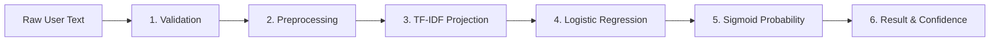

# AI-Based Fake News Detection Tool

**CODEVEDX AI/ML Internship — Task 3**  
An end-to-end Machine Learning and Natural Language Processing application to evaluate news headlines and article text for linguistic and stylometric patterns characteristic of fake or real news.

---

## 1. Project Overview

The **AI-Based Fake News Detection Tool** is designed to address the challenge of digital misinformation by analyzing the stylistic and vocabulary markers of news content. Rather than relying on black-box external APIs or deep language models that are prone to hallucination, this system uses an interpretable, highly optimized pipeline:

* **Text Preprocessing:** Removes wire datelines, strips HTML entities, removes raw URLs, and expands contractions while preserving sentiment-critical negations (*not*, *no*, *never*).
* **Feature Extraction:** Projects normalized text into a 5,000-dimensional TF-IDF space using sublinear term frequencies and unigram/bigram n-gram features.
* **Classifier:** Evaluates features using an L2-regularized Logistic Regression model trained on the ISOT Fake News Dataset.
* **Interactive UI:** A responsive Streamlit application providing real-time predictions, posterior class probability distributions, and transparent preprocessed text inspection.

---

## 2. Key Features

- **Interactive News Text Input:** Large, accessible input area supporting headlines, paragraphs, or full article bodies.
- **Binary Classification (Real vs. Fake):** Clear, visually distinct badges indicating whether an article matches legitimate journalism or misinformation patterns.
- **Prediction Confidence Scoring:** Reports model confidence as an intuitive percentage along with individual class probabilities ($P(\text{Real})$ and $P(\text{Fake})$).
- **Preset Test Examples:** One-click sample loading for legitimate Reuters reporting and sensationalist clickbait to demonstrate detection capabilities.
- **Robust Input Validation:** Rejects empty, whitespace-only, or insufficient text (< 3 words, < 10 characters) with informative error messages.
- **Explainability & Text Preview:** Expandable inspection view showing the exact normalized text passed to the TF-IDF feature extractor.
- **Production Persistence:** Pre-trained champion pipeline serialized with Joblib compression (~242 KB disk footprint), enabling instant startup and zero retraining.
- **Comprehensive Test Suite:** 114 automated unit and integration tests verifying 100% of pipeline and UI functionality.

---

## 3. Technology Stack

Verified against the Task-3 environment:

| Category | Technology | Version | Purpose |
| :--- | :--- | :--- | :--- |
| **Language** | Python | `3.11.x` | Core application and testing runtime |
| **Data Manipulation** | Pandas | `>= 2.0.0` | Dataset ingestion, cleaning, and partitioning |
| **Numerical Computing** | NumPy | `>= 1.24.0` | Matrix operations and probability estimation |
| **Machine Learning** | Scikit-learn | `>= 1.3.0` | TF-IDF vectorization and Logistic Regression |
| **Model Persistence** | Joblib | `>= 1.3.0` | Compressed pipeline serialization and loading |
| **Web Framework** | Streamlit | `>= 1.30.0` | Interactive web dashboard and user interface |
| **Testing** | Pytest | `>= 8.0.0` | Comprehensive unit and integration test suite |

---

## 4. Project Structure

```text
Task-3/
├── app.py                      # Main Streamlit web application
├── requirements.txt            # Pinned project dependencies
├── README.md                   # Project documentation and guide
├── .gitignore                  # Git ignore rules with model whitelisting
├── .streamlit/
│   └── config.toml             # Streamlit server and theme configuration
├── data/
│   ├── raw/                    # Raw ISOT dataset files (Fake.csv, True.csv)
│   └── processed/              # Stratified splits (train.csv, val.csv, test.csv)
├── docs/                       # Architectural and milestone documentation
│   ├── dataset_research.md     # Phase 4: ISOT dataset analysis & audit
│   ├── preprocessing_guide.md  # Phase 5.1: Text normalization & deduplication
│   ├── data_splitting_and_tfidf.md # Phase 5.2: Stratified split & TF-IDF
│   ├── model_training_results.md   # Phase 5.3: Model training & comparison
│   ├── inference_engine.md     # Phase 6: Prediction API & confidence scoring
│   ├── streamlit_ui_guide.md   # Phase 7: UI design & AppTest verification
│   └── deployment_guide.md     # Phase 8: Deployment instructions
├── models/
│   ├── fake_news_model.joblib  # Serialized champion model (Logistic Regression)
│   ├── logistic_regression.joblib
│   └── multinomial_nb.joblib
├── src/                        # Core Python source packages
│   ├── __init__.py
│   ├── data_loader.py          # CSV loading and schema validation
│   ├── preprocessing.py        # Text cleaning, normalization, dateline strip
│   ├── data_splitter.py        # Stratified 80/10/10 dataset partitioning
│   ├── feature_extraction.py   # TF-IDF extractor (train fit, val/test transform)
│   ├── train.py                # Model training, metric calculation, selection
│   ├── predictor.py            # Prediction API and FakeNewsPredictor engine
│   └── model_utils.py          # FakeNewsPipeline container and serialization
└── tests/                      # Automated test suite (114 tests)
    ├── __init__.py
    ├── test_data_loader.py     # 15 tests
    ├── test_preprocessing.py   # 26 tests
    ├── test_data_splitter.py   # 14 tests
    ├── test_feature_extraction.py # 12 tests
    ├── test_model_utils.py     # 8 tests
    ├── test_train.py           # 8 tests
    ├── test_predictor.py       # 19 tests
    └── test_app.py             # 12 tests
```

---

## 5. How the System Works

The inference pipeline operates deterministically in 6 sequential stages:



1. **Input Validation:** Scrutinizes the string for type safety, whitespace-only content, and minimum length (at least 3 words and 10 characters).
2. **Text Preprocessing:** Removes wire datelines (e.g. `WASHINGTON (Reuters) - `), unescapes HTML entities, strips URLs, expands contractions, and standardizes casing.
3. **TF-IDF Feature Projection:** Projects the preprocessed text onto the fixed 5,000-term vocabulary using `.transform()`. Out-of-vocabulary terms are ignored; learned IDF weights are applied.
4. **Logistic Regression:** Computes the linear dot product $z = w^T x + b$ using the frozen 5,000 weight coefficients.
5. **Sigmoid Probability Estimation:** Passes $z$ through the logistic sigmoid function $\sigma(z) = \frac{1}{1 + e^{-z}}$ to produce posterior model probabilities:
   $$P(\text{Real}) = \sigma(z), \quad P(\text{Fake}) = 1 - \sigma(z)$$
6. **Result Formatting:** Selects the winning class label, assigns confidence score $\max(P(\text{Real}), P(\text{Fake}))$, and formats the structured `PredictionResult` object.

---

## 6. Model Performance & Validation Results

During Phase 5.3 model selection, classifiers were trained on **31,280** training articles and evaluated strictly against **3,910** unseen validation articles from the ISOT Fake News Dataset.

> [!NOTE]
> **Important Distinction:** The metrics below represent strictly held-out **validation set** results on the ISOT historical corpus. They demonstrate that the model effectively learned stylistic patterns of the benchmark dataset, but do **not** imply equivalent real-world accuracy on open-domain 2026 news.

### Validation Benchmark Comparison

| Metric | Logistic Regression (Champion) | Multinomial Naive Bayes |
| :--- | :---: | :---: |
| **Validation Accuracy** | **98.95%** | 95.24% |
| **Macro F1 Score** | **0.9894** | 0.9521 |
| **Weighted F1 Score** | **0.9895** | 0.9524 |
| **Fake News Precision** | **99.16%** | 94.41% |
| **Fake News Recall** | **98.55%** | 95.25% |
| **Fake News F1** | **0.9885** | 0.9483 |
| **Real News Precision** | **98.78%** | 95.96% |
| **Real News Recall** | **99.29%** | 95.24% |
| **Real News F1** | **0.9904** | 0.9560 |
| **Total Validation Errors** | **41** (out of 3,910) | 186 (out of 3,910) |

Logistic Regression achieved a **77.96% error reduction** compared to Naive Bayes (reducing misclassifications from 186 down to 41) and was selected as the champion model.

### Precision vs. False-Positive Rate Clarification

It is essential to distinguish between **Precision** and **False Positive Rate (FPR)** on the validation set:
* **Fake News Precision ($\frac{TP}{TP + FP}$):** **99.16%** ($1,764 / 1,779$). When the champion model predicts that an article is Fake, it is correct 99.16% of the time.
* **Fake News False Positive Rate ($\frac{FP}{FP + TN}$):** **0.71%** ($15 / 2,120$). Out of 2,120 genuine Real news articles in the validation set, only 15 were incorrectly flagged as Fake news (Fall-out of $0.0071$).
* **Real News Precision ($\frac{TP}{TP + FP}$):** **98.78%** ($2,105 / 2,131$). When predicting Real, it is correct 98.78% of the time.
* **Real News False Positive Rate ($\frac{FP}{FP + TN}$):** **1.45%** ($26 / 1,790$). Out of 1,790 actual Fake articles, only 26 were incorrectly labeled as Real.

---

## 7. Installation Instructions (Windows)

### Prerequisites
- Python 3.11 installed (verify with `python --version`)
- Git installed (optional for local cloning)

### Step 1: Open PowerShell or Command Prompt
Navigate to the project directory:
```powershell
cd D:\CODEVEDX_task_3\Task-3
```

### Step 2: Create and Activate a Virtual Environment
```powershell
python -m venv venv
.\venv\Scripts\Activate.ps1
```
*(If script execution is disabled in PowerShell, run `Set-ExecutionPolicy -ExecutionPolicy RemoteSigned -Scope Process` first).*

### Step 3: Install Required Dependencies
```powershell
pip install --upgrade pip
pip install -r requirements.txt
```

---

## 8. Running the Application

Once dependencies are installed and the virtual environment is active:

```powershell
streamlit run app.py
```

Or from the repository root:
```powershell
python -m streamlit run Task-3/app.py
```

The Streamlit web dashboard will automatically open in your default browser at:
`http://localhost:8501`

---

## 9. Running Automated Tests

To run the complete test suite (114 tests) with verbose output:

```powershell
pytest tests -v
```

To run with summary output:
```powershell
pytest tests -q
```

---

## 10. Render Cloud Deployment

The application is fully prepared for deployment as a **Python Web Service on Render** from the `Amruth4146/CODEVEDX` monorepo.

### Monorepo Render Settings

Because the repository contains Task 1, Task 2, and Task 3, Render must be configured with a **Root Directory** so it builds only Task 3:

| Setting | Value |
| :--- | :--- |
| **Service Type** | Web Service |
| **Repository** | `https://github.com/Amruth4146/CODEVEDX` |
| **Branch** | `main` |
| **Runtime** | Python 3 |
| **Root Directory** | `Task-3` |
| **Build Command** | `pip install --upgrade pip && pip install -r requirements.txt` |
| **Start Command** | `streamlit run app.py --server.port=$PORT --server.address=0.0.0.0 --server.headless=true` |
| **Environment Variables** | `PYTHON_VERSION=3.11.9` |

See [docs/deployment_guide.md](docs/deployment_guide.md) for full step-by-step instructions and smoke testing checklists.

---

## 11. Limitations

When using or evaluating this tool, consider the following technical boundaries:

1. **Stylometric Pattern Recognition vs. Fact-Checking:**
   The model analyzes *how* an article is written (writing style, sensationalist phrasing, clickbait structure, punctuation patterns), not *whether* the claims in the article are physically true. It cannot search live external databases or verify event dates.
2. **Historical Domain Sensitivity:**
   The model was trained on the ISOT corpus covering US political news from the 2016–2017 election cycle. Modern events (e.g., 2026 international news) will rely on generalized language style; novel political figures and vocabulary from post-2017 are out-of-vocabulary terms and receive zero TF-IDF weight.
3. **Adversarial / Sophisticated Misinformation:**
   Well-funded or sophisticated disinformation that mimics the dry, detached style of Associated Press or Reuters reporting may not be flagged based on vocabulary alone.
4. **Input Length Constraints:**
   Predictions are reliable only for narrative articles or substantial headlines (minimum 3 words and 10 characters). Slogans, single-word inputs, or tweets with heavy slang will not be evaluated.

---

## 12. Disclaimer

> **Mandatory Notice:** This tool classifies news articles based strictly on statistical patterns learned from its training corpus. It does not independently verify facts, consult live news services, or determine whether an article is objectively true or false. Predictions may be inaccurate. This software is provided for academic, educational, and research evaluation purposes as part of the CODEVEDX AI/ML Internship.
