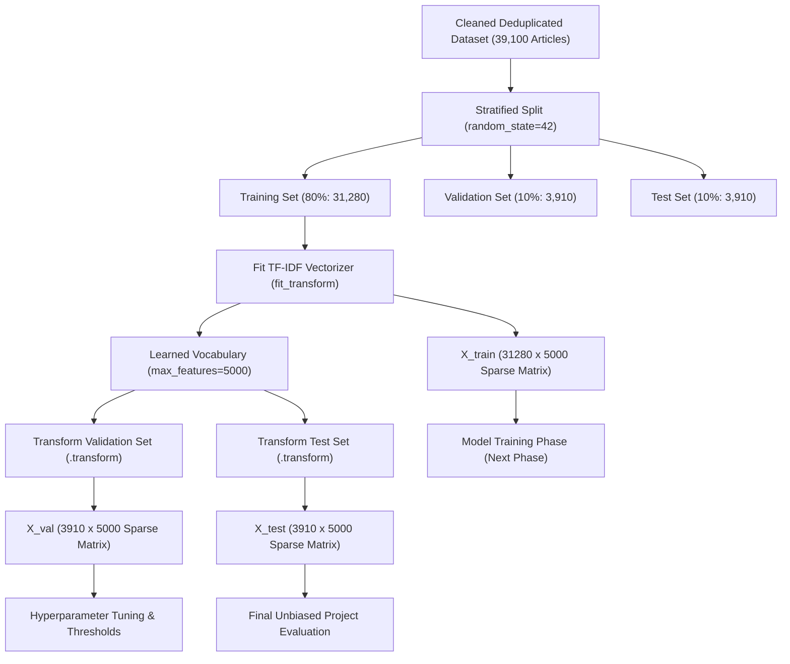

# Dataset Splitting & TF-IDF Feature Extraction Guide
**Project:** Task 3 — AI-Based Fake News Detection Tool  
**Phase:** 5.2 — Dataset Splitting & TF-IDF Feature Extraction  
**Status:** Implemented & Verified with 67 Passing Unit Tests  

---

## 1. Overview & Architecture

In Phase 5.2, we established the mathematical and structural bridge between cleaned text and machine learning classifiers.

Computers and machine learning algorithms (such as Logistic Regression and Naive Bayes) cannot directly read human sentences; they require numbers. **TF-IDF (Term Frequency-Inverse Document Frequency)** transforms raw sentences into a structured numerical matrix while reflecting the relative importance of words.

Simultaneously, we partitioned our deduplicated corpus into three strictly separated sets:
* **Training Set (80%):** 31,280 articles (54.21% Real, 45.79% Fake)
* **Validation Set (10%):** 3,910 articles (54.22% Real, 45.78% Fake)
* **Test Set (10%):** 3,910 articles (54.19% Real, 45.81% Fake)



---

## 2. Explanation of Core Concepts in Simple English

### 2.1 What is Training Data?
**Training data** is the textbook that the machine learning model studies.
* During training, the algorithm looks at thousands of examples of both Real news and Fake news along with their true answers (`1` or `0`).
* The model adjusts its internal weights and mathematical probabilities to learn which words, phrases, and structures correspond to each class.
* In our project, 80% of our corpus (31,280 articles) is reserved for training.

### 2.2 What is Validation Data?
**Validation data** is the practice quiz given to the model during development.
* The model does **not** learn its vocabulary or base weights from the validation set.
* Instead, we use the validation set to compare different algorithms (e.g., Logistic Regression vs. Naive Bayes), tune hyperparameters (e.g., regularization strength $C$, smoothing $\alpha$), and select optimal decision thresholds.
* In our project, 10% of our corpus (3,910 articles) is reserved for validation.

### 2.3 What is Testing Data?
**Testing data** is the final exam.
* The test set represents unseen real-world articles that the model has never encountered during training or tuning.
* It must remain completely isolated inside a digital "vault" until all model decisions are finalized.
* If a model scores well on the test set, we have strong scientific confidence that it generalizes well and has not simply memorized answers.
* In our project, 10% of our corpus (3,910 articles) is reserved for testing.

### 2.4 Why Do We Use Stratified Splitting?
Imagine a deck of cards with 54 red cards and 46 black cards. If you randomly dealt them into three piles without looking, one pile might accidentally end up with 70% red cards and another with only 30%.

In machine learning, this is called **distribution shift**. If the training set has a different ratio of Real/Fake articles than the test set, the model will learn misleading class priors.
* **Stratified splitting** guarantees that every partition (Train, Validation, and Test) maintains the exact same proportion of Real and Fake articles as the original corpus (~54.2% Real, ~45.8% Fake).

### 2.5 What Does `random_state` Mean?
In computer science, random number generators are pseudorandom—they use a mathematical formula starting from an initial number called a **seed**.
* If you run a split without a seed, your computer picks a different split every time it runs. This makes scientific debugging impossible because you cannot tell whether an accuracy change was caused by your code or by a different random split.
* Setting `random_state=42` ensures that anyone, anywhere in the world running our code gets the exact same train, validation, and test splits every single time. It is the cornerstone of reproducible AI research.

### 2.6 What Does TF-IDF Mean?
**TF-IDF** stands for **Term Frequency - Inverse Document Frequency**. It is a numerical statistic intended to reflect how important a word is to a document in a collection or corpus.

It is composed of two parts multiplied together:

$$\text{TF-IDF}(t, d, D) = \text{TF}(t, d) \times \text{IDF}(t, D)$$

1. **Term Frequency (TF):**  
   How frequently does word $t$ appear in document $d$?
   $$\text{TF}(t, d) = \frac{\text{Count of word } t \text{ in document } d}{\text{Total words in document } d}$$
   If the word "election" appears 10 times in an article, its TF is high.

2. **Inverse Document Frequency (IDF):**  
   How rare or common is the word across *all* articles in the corpus $D$?
   $$\text{IDF}(t, D) = \ln\left(\frac{1 + |D|}{1 + \text{DF}(t, D)}\right) + 1$$
   * A ubiquitous word like "said" or "today" appears in almost every article, so its IDF is near zero.
   * A distinctive word like "conspiracy" or "ratification" appears in only a few articles, so its IDF is very high.

### 2.7 What Does TF-IDF Do with Words?
TF-IDF acts as an automatic filter for human language:
* **Common words are penalized:** Words that appear everywhere are downweighted because they carry little discriminative power.
* **Informative words are amplified:** Words that appear frequently within a specific article, but rarely across the general news, receive high scores.
* **Phrases are captured:** By using n-grams (`(1, 2)`), TF-IDF captures pairs of words like `"fake news"`, `"white house"`, or `"not true"`.

### 2.8 Why Do We Fit TF-IDF ONLY on Training Data?
This is one of the most critical principles in applied machine learning:
* **Fitting** means learning the vocabulary, calculating word document frequencies, and computing IDF values.
* If you fit the TF-IDF vectorizer on the whole dataset (including validation or test sets), the vectorizer learns about words and term frequencies that exist in the test exam before taking the exam!
* By fitting strictly on `train_texts`:
  ```python
  extractor.fit(train_texts)  # Learns vocabulary from train only
  X_train = extractor.transform(train_texts)
  X_val = extractor.transform(val_texts)  # Projects val onto train vocabulary
  X_test = extractor.transform(test_texts)  # Projects test onto train vocabulary
  ```
  The validation and test sets remain completely unseen. Any words that appear in the test set but were not in the training set are simply ignored during inference, exactly as would happen when deployed in production.

### 2.9 What is Data Leakage?
**Data leakage** occurs when information from outside the training dataset is mistakenly used to build or influence the model.

In our project, we actively prevented three distinct forms of leakage:
1. **Target Proxy Leakage:** The `subject` column in the raw data had 0% overlap between Real and Fake. Using `subject` would give 100% artificial accuracy. We dropped it.
2. **Duplicate Leakage:** Identical fake news stories published on different blogs were removed *before* splitting. If left uncleaned, the exact same text would appear in both train and test sets, allowing the model to cheat by memorization.
3. **Vocabulary Leakage:** Fitting the TF-IDF vectorizer exclusively on training text prevents test word distributions from leaking into the feature matrix.

### 2.10 What are Sparse Matrices?
When we convert 31,280 articles into 5,000 TF-IDF features, the resulting table has:
$$31{,}280 \times 5{,}000 = 156{,}400{,}000 \text{ numbers}$$

However, any single news article only contains about 100 to 300 unique words. This means that **over 95% of the entries in that 156-million cell table are zeros!**
* If stored as a standard dense NumPy array, it would consume hundreds of megabytes of RAM unnecessarily.
* A **Compressed Sparse Row (CSR) matrix** (`scipy.sparse.csr_matrix`) stores *only* the non-zero values along with their row and column coordinates.
* This reduces memory usage by over 90% and accelerates matrix multiplication algorithms during model training.

### 2.11 Why Must Test Data Remain Isolated?
If a researcher tests a model on the test set, tweaks a setting, and tests again, the test set has effectively become part of the training feedback loop!
* The reported accuracy will be overly optimistic.
* Once the test set is touched during model design, it is contaminated.
* Therefore, the test set is sealed in `data/processed/test.csv` and will not be touched until the final project evaluation in Phase 7.

---

## 3. Explanation of the 5-Record Deduplication Discrepancy

During the review of Phase 4 vs. Phase 5.1 reports, an inquiry arose regarding why the unique record count changed:
* **Phase 4 Report:** 39,105 unique records (21,197 Real, 17,908 Fake)
* **Phase 5.1 Report:** 39,100 unique records (21,195 Real, 17,905 Fake)
* **Difference:** Exactly 5 records (2 Real, 3 Fake)

### Root Cause Analysis (Verified with Code)
1. **Phase 4 Deduplication:**  
   In Phase 4, duplicate detection used raw Python string equality on `title + " " + text`. It did not normalize case or whitespace.
2. **Phase 5.1 Deduplication:**  
   As requested by the engineering requirements in Phase 5.1, `data_loader.py` implemented normalized deduplication:
   ```python
   norm_series = (
       df["content"]
       .fillna("")
       .astype(str)
       .str.lower()
       .str.replace(r"\s+", " ", regex=True)
       .str.strip()
   )
   ```
3. **The 5 Extra Duplicates Discovered:**  
   Our forensic script inspected the exact 5 records that differed:
   * **Real News (2 records):** Sourced from Reuters Twitter factbox stories (e.g. *"Factbox: Trump on Twitter (Sept 18)"*). One version contained an invisible non-breaking space (`\xa0`) while the other had a standard ASCII space. In Phase 4, the raw strings did not match; in Phase 5.1, whitespace normalization correctly merged them.
   * **Fake News (3 records):** Articles duplicated across blogs with subtle spacing variations (e.g., *"GEORGE SOROS BOARD MEMBER  Is Chairman"* with two spaces vs. *"GEORGE SOROS BOARD MEMBER Is Chairman"* with one space).

**Conclusion:** The Phase 5.1 count of **39,100 unique articles** is higher quality and methodologically superior, as it successfully eliminates whitespace and capitalization duplicates that would otherwise leak across splits.

---

## 4. Preprocessing Strategy & Punctuation Findings

In Step 4, we investigated whether aggressive punctuation removal is appropriate for fake news detection:

```text
Stylistic Comparison on Raw Data:
- Fake News Titles: 3,272 exclamation marks (!)
- Real News Titles: 18 exclamation marks (!)
- Fake News Titles: 68,055 all-caps words
- Real News Titles: 2,004 all-caps words
```

### Decision & Justification:
* **Aggressive punctuation removal is NOT appropriate as the default baseline.**
* Removing exclamation marks, question marks, and uppercase emphasis destroys some of the strongest signals of sensationalist misinformation.
* Therefore, we created three configurable cleaning modes in `Task-3/src/preprocessing.py`:
  1. `minimal`: Strips dateline, HTML, URLs, and normalizes whitespace. Preserves all casing and punctuation (ideal for clickbait analysis).
  2. `standard` (**Recommended Baseline**): Minimal + contraction expansion (`didn't` $\rightarrow$ `did not`) + lowercase. Preserves negations while standardizing vocabulary; leaves punctuation intact.
  3. `aggressive`: Standard + non-alphanumeric punctuation removal.

---

## 5. Summary of Partition Dimensions & Leakage Audit

```
+----------------------------------------------------------------------------------------+
|                                DATASET SPLIT AUDIT                                     |
+-------------------+----------------+------------------+------------------+-------------+
| Partition         | Total Records  | Real News (1)    | Fake News (0)    | Target Ratio|
+-------------------+----------------+------------------+------------------+-------------+
| Full Corpus       | 39,100         | 21,195 (54.21%)  | 17,905 (45.79%)  | 1.18 : 1    |
| Training Set (80%)| 31,280         | 16,956 (54.21%)  | 14,324 (45.79%)  | 1.18 : 1    |
| Validation Set(10%)| 3,910         |  2,120 (54.22%)  |  1,790 (45.78%)  | 1.18 : 1    |
| Test Set (10%)    |  3,910         |  2,119 (54.19%)  |  1,791 (45.81%)  | 1.18 : 1    |
+-------------------+----------------+------------------+------------------+-------------+
| Cross-Split Leakage Check:                                                             |
| - Train & Validation Text Overlap : 0 articles                                         |
| - Train & Test Text Overlap       : 0 articles                                         |
| - Validation & Test Text Overlap  : 0 articles                                         |
| - Data Leakage Status             : ZERO LEAKAGE DETECTED                              |
+----------------------------------------------------------------------------------------+
```
