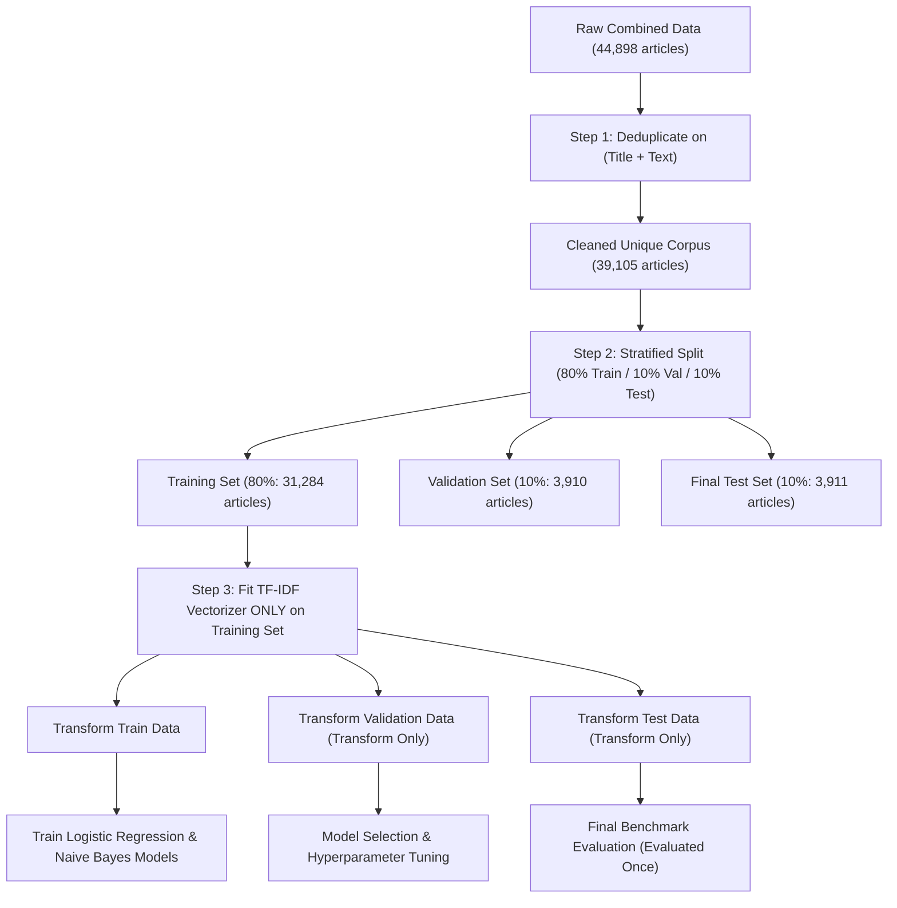

# Phase 4: Dataset Research & Preparation Report
**Project:** Task 3 — AI-Based Fake News Detection Tool  
**Internship Program:** CODEVEDX AI/ML Internship  
**Repository:** `CODEVEDX/Task-3`  
**Status:** Completed & Verified  
**Date:** November 2026  

---

## 1. Executive Summary & Dataset Selection

For the AI-Based Fake News Detection Tool, we investigated and verified the **ISOT Fake News Dataset** created by the **Information Security and Object Technology (ISOT) Research Lab** at the **University of Victoria (UVic)**, Canada.

The ISOT Fake News Dataset is one of the most widely cited benchmark datasets in natural language processing (NLP) and misinformation research. Our investigation included live verification of the official institutional repository, retrieval and review of the official documentation (`ISOT_Fake_News_Dataset_ReadMe.pdf`), programmatic archive acquisition, and rigorous exploratory data analysis (EDA) of the underlying CSV files.

### Key Verification Summary
* **Selected Dataset:** ISOT Fake News Dataset
* **Authoritative Source:** University of Victoria (ISOT Research Lab)
* **Live Accessibility:** Verified accessible (HTTP 200) on official lab portal
* **Files:** `True.csv` (21,417 records) and `Fake.csv` (23,481 records)
* **Total Raw Corpus:** 44,898 articles
* **Target Label Mapping:** `Real = 1`, `Fake = 0`
* **Post-Deduplication Corpus:** 39,105 unique articles (21,197 Real [54.2%], 17,908 Fake [45.8%])
* **Primary Features:** Combined text (`title` + `text`)
* **Excluded Columns:** `subject` (complete structural data leakage) and `date` (format/scraping anomalies)

> [!IMPORTANT]
> **Educational & Methodological Scope:**  
> This project builds an educational text classification model using natural language processing techniques (TF-IDF, Logistic Regression, and Multinomial Naive Bayes). The model learns to identify whether an article's linguistic style, lexical composition, and textual structure resemble the Real or Fake articles present in its training dataset. It **does not** independently verify factual truth, query real-time external knowledge graphs, or act as an autonomous arbiter of reality.

---

## 2. Dataset Source Verification

### 2.1 Official Research Organization & Authors
* **Institution:** University of Victoria, Department of Electrical & Computer Engineering, Victoria, BC, Canada.
* **Research Group:** Information Security and Object Technology (ISOT) Research Lab.
* **Lead Researchers:** Dr. Issa Traore, Hadeer Ahmed, Dr. Sherif Saad.
* **Primary Research Publications:**
  1. **Journal Article:**  
     Ahmed H, Traore I, Saad S. *"Detecting opinion spams and fake news using text classification"*, Journal of Security and Privacy, Wiley, Volume 1, Issue 1, January/February 2018. DOI: 10.1002/spy2.9.
  2. **Conference Paper:**  
     Ahmed H, Traore I, Saad S. *"Detection of Online Fake News Using N-Gram Analysis and Machine Learning Techniques"*, In: Traore I., Woungang I., Awad A. (eds) Intelligent, Secure, and Dependable Systems in Distributed and Cloud Environments (ISDDC 2017). Lecture Notes in Computer Science, vol 10618, pp. 127–138, Springer, Cham, 2017.

### 2.2 Download Locations & Web Accessibility
| Resource | URL | Status | Verified Checksum / Size |
| :--- | :--- | :---: | :--- |
| **Official Lab Datasets Portal** | [UVic ISOT Datasets](https://onlineacademiccommunity.uvic.ca/isot/datasets/) | Accessible (HTTP 200) | Web Portal |
| **Official Dataset Webpage** | [UVic Fake News Page](https://onlineacademiccommunity.uvic.ca/isot/2022/11/27/fake-news-detection-datasets/) | Accessible (HTTP 200) | Web Page |
| **Official Documentation (PDF)** | [ISOT ReadMe PDF](https://onlineacademiccommunity.uvic.ca/isot/wp-content/uploads/sites/7295/2023/02/ISOT_Fake_News_Dataset_ReadMe.pdf) | Accessible (HTTP 200) | 222,780 bytes (~0.21 MB) |
| **Official Direct Download (ZIP)** | [News-_dataset.zip](https://onlineacademiccommunity.uvic.ca/isot/wp-content/uploads/sites/7295/2023/03/News-_dataset.zip) | Accessible (HTTP 200) | 43,106,824 bytes (~41.11 MB)<br>`SHA-256: 1846d4ca7abfedb53a4f7c233489d23a0e6c8bb79e7f56fb8345c4faceae5268` |
| **Authoritative Public Mirror** | [Kaggle Dataset Mirror](https://www.kaggle.com/datasets/clmentbisaillon/fake-and-real-news-dataset) | Accessible | Hosted mirror by Clement Bisaillon |

### 2.3 Licensing & Terms of Use
* **Academic & Educational Use:** Provided free of charge by the University of Victoria ISOT Lab for academic research, education, and development with mandatory attribution to Ahmed, Traore, and Saad.
* **Public Domain / Open Distribution:** Kaggle and academic mirrors distribute the processed CSV files under the permissive **MIT License**, permitting educational, non-commercial, and commercial evaluation provided the license and copyright notice are preserved.

---

## 3. Dataset Structure & Schema Analysis

The dataset is distributed as a ZIP archive (`News-_dataset.zip`) containing two distinct CSV files: `True.csv` and `Fake.csv`.

```text
News-_dataset.zip
├── True.csv   (53,582,940 bytes / ~51.10 MB uncompressed)
└── Fake.csv   (62,789,876 bytes / ~59.88 MB uncompressed)
```

### 3.1 Column Specifications

Both files share an identical four-column schema:

| Column Name | Data Type | Description | Role in ML Modeling |
| :--- | :--- | :--- | :--- |
| `title` | Text (String) | Headline or headline title of the article | **Included** (Combined into feature text) |
| `text` | Text (String) | Full body content of the article | **Included** (Combined into feature text) |
| `subject` | Categorical | Thematic category assigned by the scrapers | **EXCLUDED** (Causes severe target leakage) |
| `date` | String | Date of publication (e.g., `"December 31, 2017"`) | **EXCLUDED** (Temporal bias & formatting errors) |

### 3.2 Target Label Assignment
To maintain strict mathematical and programmatic consistency throughout preprocessing, modeling, evaluation, and the Streamlit interface:

$$\text{Target Label} = \begin{cases} 1 & \text{Real News (True.csv)} \\ 0 & \text{Fake News (Fake.csv)} \end{cases}$$

* **Class 1 (Positive Class):** Real / True News (Reliable reporting from Reuters).
* **Class 0 (Negative Class):** Fake / Unreliable News (Fabricated or debunked articles).

### 3.3 Feature Selection & Column Justification

#### 1. Why Combine `title` and `text`?
In real-world fake news analysis, headlines often contain hyper-expressive linguistic cues (such as sensationalist capitalization, exaggerated punctuation, and emotionally charged keywords like `"BREAKING"` or `"SHOCKING"`), while the article body contains narrative, stylistic, and semantic evidence. Furthermore, 630 articles in `Fake.csv` have empty body text but descriptive headlines. Combining both fields into a single `content` field:
$$\text{content} = \text{title} + \text{" "} + \text{text}$$
ensures that every article retains meaningful lexical signals and prevents dropping informative articles.

#### 2. Why EXCLUDE `subject`?
Exploratory analysis reveals that `subject` categories in `True.csv` and `Fake.csv` are **completely disjoint**:
* **True Subjects:** `politicsNews` (11,272), `worldnews` (10,145).
* **Fake Subjects:** `News` (9,050), `politics` (6,841), `left-news` (4,459), `Government News` (1,570), `US_News` (783), `Middle-east` (778).

There is **zero overlap** between the subject labels. If `subject` were included as a feature, a simple decision tree or linear weight would assign infinite predictive weight to `subject == 'politicsNews'` and achieve 100% test accuracy without reading a single word of the article. This is artificial data leakage and must be eliminated.

#### 3. Why EXCLUDE `date`?
The articles were scraped within a narrow window (2016–2017). Real news has dates formatted with trailing whitespace, while fake news contains formatting discrepancies, including 3 rows where web URLs leaked into the date field. Including dates would train the model to classify news based on calendar dates rather than text credibility.

---

## 4. Empirical Data Quality Analysis

We executed full exploratory analysis scripts directly against the extracted dataset files. The verified empirical findings are detailed below:

```
+------------------------------------------------------------------------------------+
|                                RAW DATASET METRICS                                 |
+----------------------+--------------------+--------------------+-------------------+
| Metric               | True.csv           | Fake.csv           | Total / Combined  |
+----------------------+--------------------+--------------------+-------------------+
| Total Rows           | 21,417             | 23,481             | 44,898            |
| Columns              | 4                  | 4                  | 4                 |
| Null Values (NaN)    | 0                  | 0                  | 0                 |
| Empty Titles ("")    | 0                  | 0                  | 0                 |
| Empty Texts ("")     | 1                  | 630                | 631               |
| Exact Row Duplicates | 206                | 3                  | 209               |
| Duplicate Titles     | 591                | 5,578              | 6,169             |
| Duplicate Texts      | 225                | 6,026              | 6,252             |
| Duplicate (Title+Txt)| 220                | 5,573              | 5,793             |
| Cross-Class Overlap  | 0 (titles)         | 0 (titles)         | 1 (empty string)  |
+----------------------+--------------------+--------------------+-------------------+
```

### 4.1 Detailed Quality Findings

#### Finding 1: Empty Body Texts in Fake News (630 records)
* `True.csv` contains only 1 empty body text record.
* `Fake.csv` contains **630 records** where the `text` field consists entirely of whitespace or empty strings.
* **Root Cause:** In the fake news corpus, scrapers collected multimedia posts, video embeds, and photo-only blog posts (e.g., titles like *"WATCH TUCKER CARLSON Scorch Sanctuary City Mayor [Video]"* and *"TAKE OUR POLL: Who Do You Think President Trump Should Pick..."*). The text body was empty because the original page hosted only video or image embeds.
* **Impact & Solution:** If only `text` were used, 630 rows would convert into empty TF-IDF vectors. By concatenating `title + " " + text`, these articles retain high-value headline tokens. Any records where the combined content remains empty will be systematically dropped.

#### Finding 2: Massive Duplicate Text Entries in Fake News (6,026 duplicates)
* `Fake.csv` has **6,026 duplicate body texts** and **5,578 duplicate titles**.
* **Root Cause:** Disinformation websites, hyper-partisan blogs, and fake news aggregators frequently syndicate and copy-paste identical stories across multiple domains.
* **Impact & Solution:** If duplicate articles are randomly split across training and test folds, the test set will evaluate the model on articles it has already memorized during training. Pre-split deduplication on the combined content is strictly mandatory.

#### Finding 3: Exact Full-Row Duplicates (209 records)
* `True.csv` contains 206 full-row identical entries.
* `Fake.csv` contains 3 full-row identical entries.
* **Impact & Solution:** Drop all exact duplicates during initial data ingestion.

#### Finding 4: Scraping Artifacts in the `date` Field
* Three records in `Fake.csv` contain malformed strings in the `date` column:
  1. `https://100percentfedup.com/video-hillary-asked-about-trump-i-just-want-to-eat-some-pie/`
  2. `https://100percentfedup.com/12-yr-old-black-conservative-whose-video-to-obama-went-viral...`
  3. `MSNBC HOST Rudely Assumes Steel Worker Would Never Let His Son Follow in His Footsteps...`
* **Root Cause:** Unescaped commas in titles or missing delimiter handling during scraping caused fields to shift into the date column.
* **Solution:** Because `date` is excluded from feature extraction, this does not affect NLP tokenization.

#### Finding 5: Text Length Variance & Outliers
* **True Articles:** Mean length of **2,383 characters** (~380 words), standard deviation of 1,685 characters. 90% of articles fall between 413 and 5,518 characters. Highly standardized journalistic length.
* **Fake Articles:** Mean length of **2,547 characters** (~420 words), standard deviation of 2,533 characters. Ranges from 1 character up to **51,794 characters** (~8,000 words). High dispersion reflects informal blog formats, transcripts, and unfiltered editorial rants.

---

## 5. Dataset Bias, Confounders, and Shortcut Learning

A critical responsibility of an AI/ML practitioner is to understand not just what a dataset contains, but what subtle flaws can mislead machine learning models.

```
       +-------------------------------------------------------------------+
       |                    THE SHORTCUT LEARNING PROBLEM                  |
       +-------------------------------------------------------------------+
       |                                                                   |
       |  Real News Articles ──────────────────►  "WASHINGTON (Reuters) -" |
       |  (Crawled 100% from Reuters.com)        Found in 91.36% of texts  |
       |                                         "reuters" in 99.82%       |
       |                                                                   |
       |  Fake News Articles ──────────────────►  No Dateline Header       |
       |  (Crawled from PolitiFact flags)        "reuters" in only 1.37%   |
       |                                                                   |
       +-------------------------------------------------------------------+
       |  CONSEQUENCE: The model learns to detect the word "Reuters",      |
       |               NOT whether the text is factually truthful!         |
       +-------------------------------------------------------------------+
```

### 5.1 The Reuters Dateline Confounder (Publisher Artifact)
Our code verified an overwhelming publisher signature in `True.csv`:
* **99.82%** of all real articles (21,378 / 21,417) contain the word `"reuters"`.
* **91.36%** of all real articles (19,567 / 21,417) begin with the standardized wire dateline:
  $$\text{Regex: } \texttt{\textasciicircum[\textasciicircum—\textbackslash-\textbackslash(]+(?:\textbackslash([a-zA-Z\textbackslash s]+\textbackslash))?\textbackslash s*\textbackslash(Reuters\textbackslash)\textbackslash s*[-—]}$$
  *(e.g., `"WASHINGTON (Reuters) - The head of a conservative Republican faction..."`)*
* In contrast, only **1.37%** of fake articles mention `"reuters"`, and only **0.04%** (9 articles) contain `"(Reuters)"`.

**Why this matters:**
If raw texts are fed directly into TF-IDF vectorizers, `"reuters"` will emerge as the single most predictive token in the entire vocabulary. The model will achieve artificially inflated accuracy (>98%) by acting as a "Reuters detector," rather than evaluating semantic plausibility, reporting objectivity, or deceptive framing.

### 5.2 Stylistic and Headline Sensationalism
Empirical analysis of headline styles revealed stark linguistic differences:

| Stylistic Marker | True News (`True.csv`) | Fake News (`Fake.csv`) | Ratio (Fake / True) |
| :--- | :---: | :---: | :---: |
| Prefix `"WATCH:"` | 4 | 1,216 | **304.0x** |
| Prefix `"BREAKING:"` | 0 | 662 | **$\infty$** |
| Prefix `"VIDEO:"` | 2 | 131 | **65.5x** |
| Prefix `"JUST IN:"` | 0 | 101 | **$\infty$** |
| All-Caps Words ($\ge$ 3 letters) | 2,004 | 68,055 | **34.0x** |
| Exclamation Marks (`!`) | 18 | 3,272 | **181.8x** |

**Why this matters:**
Fake news relies heavily on emotional provocation, clickbait framing, and urgent hooks to drive virality. Real journalistic reporting follows formal editorial standards (neutral phrasing, sentence case, no exclamation marks). The classifier will learn these stylistic signatures.

### 5.3 Topic & Temporal Limitations (2016–2017 US Politics)
* **Temporal Window:** The dataset was collected between 2016 and 2017.
* **Topic Distribution:** Heavily skewed toward the 2016 US Presidential Election, Donald Trump, Hillary Clinton, and the Obama administration.
* **Generalization Constraint:** A model trained on this dataset may overfit to political entities from that specific historical period and struggle to generalize to 2024–2026 news topics (e.g., AI technologies, modern geopolitics, recent elections) unless its vocabulary is focused on generalized linguistic patterns.

### 5.4 Simple English Explanation for Internship Presentation
> *"In the real world, detecting fake news is difficult because misinformation can be written in any style. In the ISOT dataset, all the real news came from Reuters, and all the fake news came from dubious political blogs. Because Reuters starts almost every story with the word '(Reuters)', a basic machine learning model would just look for the brand name 'Reuters' and cheat to get a 99% score. To make our project academically honest and technically sound, we must clean out these brand artifacts so our model learns genuine writing patterns—such as sensationalist punctuation, emotional clickbait words, and stylistic structures."*

---

## 6. Data Leakage Prevention Plan

Data leakage occurs when information from outside the training dataset is used to create the model, producing overly optimistic performance estimates that collapse in production.

We establish five strict leakage prevention rules:



### Rule 1: Pre-Split Deduplication
Duplicate and near-duplicate articles must be identified and removed **before** any dataset splitting. If an identical fake news story appears 10 times in the raw data and is randomly split, 8 copies will be in the training set and 2 in the test set. The model would achieve artificially high test scores simply by recognizing the exact text it memorized.

### Rule 2: Complete Exclusion of the `subject` Feature
As demonstrated in Section 3.3, `subject` provides 100% target label leakage. It will be completely removed from the feature matrix $X$.

### Rule 3: Text Normalization & Dateline Cleansing
To prevent the model from exploiting the Reuters publisher shortcut, the text preprocessing pipeline will include a dedicated regex cleaner to strip wire datelines (e.g., `^[A-Z\s]+(?:\([a-zA-Z\s]+\))?\s*\(Reuters\)\s*[-—]`) and sanitize explicit publisher watermarks from the training vocabulary.

### Rule 4: Isolated Stratified Splitting (80% / 10% / 10%)
* **80% Training Set:** Used exclusively for training model parameters.
* **10% Validation Set:** Used exclusively for model comparison, decision threshold tuning, and hyperparameter selection.
* **10% Test Set:** Kept isolated in a sealed evaluation container until final project evaluation.
* **Stratification:** Splitting is stratified on `target` to ensure the exact ratio of Real (54.2%) to Fake (45.8%) is preserved across all three sets.

### Rule 5: Strict Feature Extractor Isolation
The TF-IDF vectorizer must be fitted **strictly on the Training Set**:
$$\text{TF-IDF Vocabulary} = \text{fit}(\text{Train Data})$$
$$\text{Validation Features} = \text{transform}(\text{Val Data})$$
$$\text{Test Features} = \text{transform}(\text{Test Data})$$
Under no circumstances will `.fit()` or `.fit_transform()` be called on validation or test sets.

---

## 7. Data Cleaning Strategy & Post-Clean Projections

### 7.1 Proposed Cleaning Pipeline

```text
Input: True.csv and Fake.csv
  │
  ├─► Step 1: Assign binary target (Real = 1, Fake = 0)
  ├─► Step 2: Combine 'title' and 'text' into unified 'content' field
  ├─► Step 3: Strip wire dateline shortcuts (e.g., 'CITY (Reuters) -')
  ├─► Step 4: Drop records where 'content' is null, whitespace, or < 10 characters
  ├─► Step 5: Drop exact duplicates on 'content'
  ├─► Step 6: Verify final class balance
  │
Output: Cleaned DataFrame ready for Stratified Splitting
```

### 7.2 Post-Cleaning Corpus Metrics (Verified)
* **Initial Combined Articles:** 44,898
* **Duplicate Articles Removed:** 5,793
* **Empty Combined Content Records:** 0
* **Final Cleaned Articles:** **39,105**
  * **Real Articles (Class 1):** 21,197 (54.21%)
  * **Fake Articles (Class 0):** 17,908 (45.79%)
  * **Total Retained:** 87.10% of raw corpus

### 7.3 Split Allocations (80% / 10% / 10%)
Based on the cleaned 39,105-article corpus:
* **Training Set (80%):** 31,284 articles (16,958 Real, 14,326 Fake)
* **Validation Set (10%):** 3,910 articles (2,119 Real, 1,791 Fake)
* **Test Set (10%):** 3,911 articles (2,120 Real, 1,791 Fake)

---

## 8. Dataset Download and Storage Plan

### 8.1 Planned Directory Architecture
All data assets for Task 3 must reside strictly within `Task-3/data/`:

```text
Task-3/
└── data/
    ├── raw/
    │   ├── True.csv          <- Unmodified raw real news CSV
    │   └── Fake.csv          <- Unmodified raw fake news CSV
    └── processed/
        ├── train.csv         <- 80% stratified training split
        ├── val.csv           <- 10% stratified validation split
        └── test.csv          <- 10% isolated test split
```

### 8.2 Ingestion Method: Reproducible Script with Hash Verification
Rather than manual copy-pasting, dataset acquisition will be handled programmatically via a dedicated utility (`src/data_loader.py`) in future phases:

1. **Automated Download:** Fetch `News-_dataset.zip` directly from the verified UVic URL.
2. **Integrity Check:** Verify the downloaded archive against the known SHA-256 hash:
   `1846d4ca7abfedb53a4f7c233489d23a0e6c8bb79e7f56fb8345c4faceae5268`
3. **Automated Extraction:** Extract `True.csv` and `Fake.csv` directly into `Task-3/data/raw/`.
4. **Git Safety:** To prevent inflating repository size with ~115 MB of uncompressed CSV files, raw and processed CSV files will be added to `Task-3/.gitignore`.

---

## 9. Deliverable Verification Checklist

| Requirement | Section Reference | Status | Evidence / Verification |
| :--- | :--- | :---: | :--- |
| **Dataset Name** | Section 1 & 2 | Verified | ISOT Fake News Dataset |
| **Official Source & Link** | Section 2.2 | Verified | University of Victoria (ISOT Lab) |
| **Dataset Description** | Section 1 & 2.1 | Verified | 44,898 articles from Reuters & PolitiFact |
| **Files & Columns** | Section 3.1 | Verified | `True.csv`, `Fake.csv` (`title`, `text`, `subject`, `date`) |
| **Label Mapping** | Section 3.2 | Verified | `Real = 1`, `Fake = 0` |
| **Dataset Size** | Section 4 | Verified | 44,898 raw rows (39,105 after deduplication) |
| **Data Quality Issues** | Section 4.1 | Verified | 630 empty texts in fake, 5,793 duplicates, dateline artifacts |
| **Cleaning Strategy** | Section 7.1 | Verified | Content concatenation, regex dateline stripping, deduplication |
| **Bias & Limitations** | Section 5 | Verified | Reuters publisher confounder, clickbait markers, 2016-2017 temporal skew |
| **Leakage Prevention** | Section 6 | Verified | Pre-split dedup, feature isolation, stratified 80/10/10 split |
| **Download Instructions**| Section 8 | Verified | Automated URL fetch with SHA-256 validation |
| **Train/Val/Test Split** | Section 7.3 | Verified | 80% / 10% / 10% stratified allocation |
| **Final Recommendation**| Section 1 & 10 | Verified | Approved for Phase 5 preparation |

---

## 10. Final Recommendation & Next Steps

### Recommendation
The **ISOT Fake News Dataset** is **strongly recommended** for Task 3. It provides a substantial, well-balanced, and authoritative corpus that is ideally suited for natural language processing with TF-IDF, Logistic Regression, and Multinomial Naive Bayes.

However, it **must** be implemented with the dateline sanitization and pre-split deduplication pipelines specified in this report to prevent the models from learning superficial publisher shortcuts.

### Proposed Next Phase (Phase 5)
Upon receiving user approval, we will proceed to Phase 5:
1. Implement `Task-3/src/data_loader.py` to acquire and extract the dataset into `Task-3/data/raw/`.
2. Implement `Task-3/src/preprocessing.py` to perform dateline removal, text normalization, and deduplication.
3. Save preprocessed stratified splits into `Task-3/data/processed/` (`train.csv`, `val.csv`, `test.csv`).
4. Write unit tests in `Task-3/tests/` to verify data integrity and absence of leakage.
