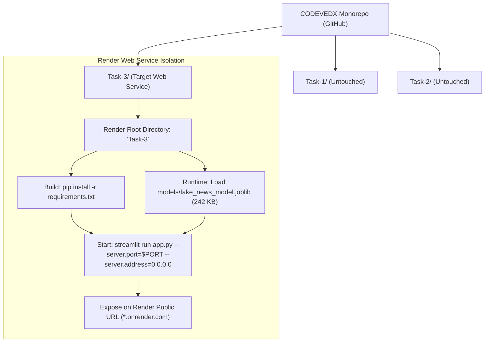

# Render Deployment Guide: AI-Based Fake News Detection Tool

**Project:** Task 3 — AI-Based Fake News Detection Tool  
**Platform:** Render (Web Service)  
**Repository Context:** Monorepo (`https://github.com/Amruth4146/CODEVEDX`) containing Task 1, Task 2, and Task 3  
**Status:** Audited & Ready for Deployment  

---

## 1. Overview & Monorepo Architecture

This application is engineered for deployment as a native **Python Web Service on Render**. 

Because the CODEVEDX repository is a monorepo containing multiple internship projects (`Task-1/`, `Task-2/`, and `Task-3/`), Render must be instructed to build and execute **only Task 3**. This is accomplished cleanly using Render's native **Root Directory** setting.



---

## 2. Exact Render Configuration Settings

When creating the Web Service in the Render Dashboard, specify the following parameters:

| Configuration Field | Exact Setting | Rationale |
| :--- | :--- | :--- |
| **Service Type** | **Web Service** | Hosted HTTP/HTTPS web application |
| **Repository** | `https://github.com/Amruth4146/CODEVEDX` | Connected GitHub monorepo |
| **Branch** | `main` | Production deployment branch |
| **Runtime** | **Python 3** | Native Render Python environment |
| **Root Directory** | **`Task-3`** | **CRITICAL for monorepo:** Restricts build and execution context exclusively to `Task-3/` |
| **Build Command** | `pip install --upgrade pip && pip install -r requirements.txt` | Installs dependencies into isolated Linux container |
| **Start Command** | `streamlit run app.py --server.port=$PORT --server.address=0.0.0.0 --server.headless=true` | Binds Streamlit to Render's dynamic `$PORT` and external host `0.0.0.0` |
| **Plan Type** | **Free** (or Starter) | Requires < 512 MB RAM (cold model footprint is ~242 KB, runtime memory is ~180 MB) |

---

## 3. Environment Variables

Configure the following environment variable in the Render Service settings:

| Key | Value | Purpose |
| :--- | :---: | :--- |
| `PYTHON_VERSION` | `3.11.9` | Locks Render's Python runtime to match local development (supported by `.python-version`) |

*Note: No database credentials, secret keys, or paid API tokens are required. The inference pipeline is completely self-contained.*

---

## 4. Port Binding & Networking Details

Render assigns a dynamic port at startup via the `$PORT` environment variable (typically `10000`). For the service to become live and pass Render's health checks:
1. **Dynamic Port Binding:** The Start Command explicitly passes `--server.port=$PORT`.
2. **External Interface Binding:** The Start Command specifies `--server.address=0.0.0.0`. In addition, [Task-3/.streamlit/config.toml](file:///d:/CODEVEDX_task_3/Task-3/.streamlit/config.toml) defines `address = "0.0.0.0"` and `headless = true` as defensive fallbacks.
3. **Health Check Path:** Render's HTTP health checks automatically probe `/_stcore/health`, which is built into Streamlit and responds with HTTP 200 OK once the app is ready.

---

## 5. Model Artifact & Git Inclusion

* **Champion Model Location:** `Task-3/models/fake_news_model.joblib`.
* **Size:** **247,741 bytes (~242 KB)**.
* **Git Tracking:** Whitelisted in `Task-3/.gitignore` via `!models/fake_news_model.joblib`.
  Because the model file is well below GitHub's 100 MB ceiling, Git LFS is **not** required.
* **Dataset Exclusion:** Raw datasets (`data/raw/*.csv`) and processed splits (`data/processed/*.csv`) are strictly ignored by `.gitignore` to prevent bloating the Git repository.

---

## 6. Step-by-Step Render Deployment Instructions

### Step 1: Stage and Push Task-3 to GitHub
*(Execute from repository root when ready to deploy)*
```bash
git add Task-3/
git commit -m "feat(task-3): configure Streamlit fake news detection tool for Render deployment"
git push origin main
```

### Step 2: Create Web Service on Render
1. Log in to your [Render Dashboard](https://dashboard.render.com/).
2. Click **"New +"** and select **"Web Service"**.
3. Choose **"Build and deploy from a Git repository"** and select `Amruth4146/CODEVEDX`.
4. Configure the service settings:
   - **Name:** `codevedx-fake-news-detector`
   - **Region:** Choose the closest region (e.g., Frankfurt, Oregon, Singapore).
   - **Branch:** `main`
   - **Root Directory:** `Task-3`
   - **Runtime:** `Python 3`
   - **Build Command:** `pip install --upgrade pip && pip install -r requirements.txt`
   - **Start Command:** `streamlit run app.py --server.port=$PORT --server.address=0.0.0.0 --server.headless=true`
5. Open **"Advanced"**:
   - Add Environment Variable:
     - Key: `PYTHON_VERSION`
     - Value: `3.11.9`
   - Set **Health Check Path** (optional): `/_stcore/health`
6. Click **"Create Web Service"**.

---

## 7. Post-Deployment Smoke Test Checklist

Once the Render build succeeds and shows `Your service is live`:
- [ ] Open the Render public URL (`https://codevedx-fake-news-detector.onrender.com`).
- [ ] Confirm the header `📰 AI-Based Fake News Detection` and warning disclaimer render immediately.
- [ ] Click **"📰 Load Real News Example"** $\rightarrow$ Click **"🔍 Classify News"** $\rightarrow$ Verify green **REAL NEWS** card appears.
- [ ] Click **"🚨 Load Fake News Example"** $\rightarrow$ Click **"🔍 Classify News"** $\rightarrow$ Verify red **FAKE NEWS** card appears.
- [ ] Click **"🔄 Clear / Reset"** $\rightarrow$ Click **"🔍 Classify News"** on empty input $\rightarrow$ Confirm informative validation error message appears without crashing.
- [ ] Expand **"View Cleaned Text Representation"** $\rightarrow$ Confirm preprocessed text preview displays.
- [ ] Review the sidebar to verify model specs (Logistic Regression, TF-IDF 5,000 features, 98.95% validation accuracy).
