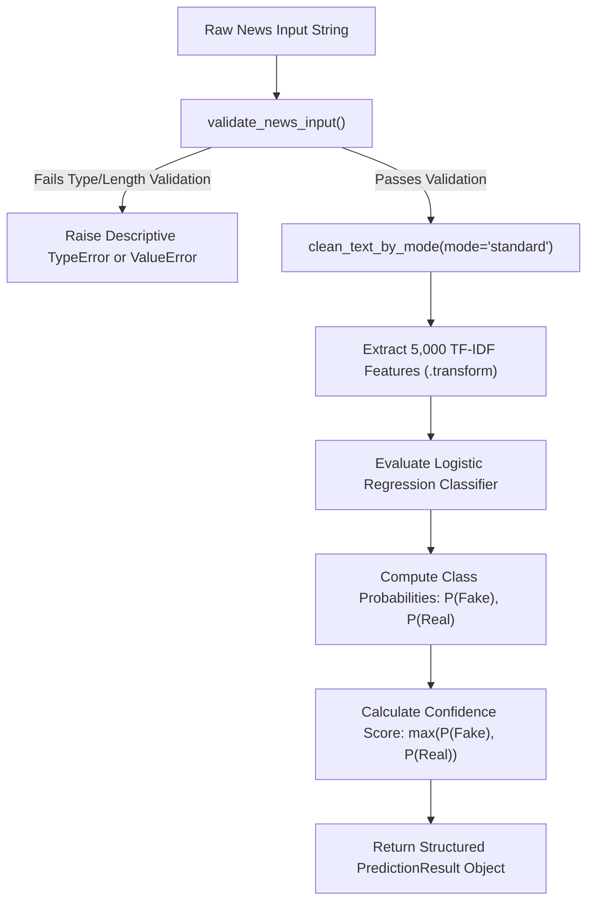

# Inference Engine & Prediction API Guide
**Project:** Task 3 — AI-Based Fake News Detection Tool  
**Phase:** 6 — Inference Engine / Prediction API  
**Status:** Completed & Empirically Verified (102 Passing Unit Tests)  

---

## 1. Overview & Architecture

The **Inference Engine** (`src/predictor.py`) serves as the production-ready prediction API for the AI-Based Fake News Detection Tool. It provides a clean, validated, and optimized interface that loads our trained champion model (`Logistic Regression`) and evaluates new text inputs without retraining or repeated disk reads.



### Core Design Principles
1. **Zero Retraining on Ingestion:** The engine loads the serialized pipeline (`Task-3/models/fake_news_model.joblib`) containing the frozen classifier weights and fitted TF-IDF vocabulary.
2. **In-Memory Caching:** The predictor uses a cached singleton pattern (`get_default_predictor()`) to load model weights into RAM once, serving subsequent predictions in milliseconds.
3. **Defensive Input Validation:** Rejects `None`, non-string types, empty strings, and inputs with fewer than 3 words or 10 characters, preventing misleading classifications on meaningless queries.
4. **Prediction Confidence Scoring:** Outputs explicit model probability distributions ($P(\text{Fake})$ and $P(\text{Real})$) where confidence equals the winning class's posterior probability.
5. **Educational Disclaimer:** Embeds a mandatory notice in every output confirming that predictions represent linguistic similarity to the training dataset rather than live factual verification.

---

## 2. How the Inference Pipeline Works (Step-by-Step)

### Step 1: Input Validation & Sanitization
Before any math or tokenization is performed, raw input text is scrutinized by `validate_news_input()`:
* **Type Safety:** Non-string inputs (integers, booleans, lists, dictionaries) or `None` raise an immediate `TypeError`.
* **Empty / Whitespace Check:** Empty strings (`""`) or whitespace-only inputs (`"   \n\t  "`) raise a `ValueError`.
* **Minimum Threshold:** Genuine news articles or headlines contain narrative content. Inputs with fewer than 3 words or 10 characters (e.g. `"hi"`, `"Breaking news"`) raise a `ValueError`.
* **Maximum Length Safety:** Extremely long inputs (>100,000 characters) are safely truncated to prevent memory exhaustion or denial-of-service.

### Step 2: Text Normalization (`preprocessing.py`)
The validated text is passed through the standard text cleaner:
1. **Lead Dateline Removal:** Wire datelines (e.g., `"WASHINGTON (Reuters) - "`) are stripped from the start of the text.
2. **HTML & Entity Cleaning:** Tags (`<p>`, `<div>`) are removed and entities (`&amp;` $\rightarrow$ `&`, `&quot;` $\rightarrow$ `"`) are unescaped.
3. **URL Stripping:** Hyperlinks (`https://...`, `www....`) are replaced with spaces.
4. **Contraction Expansion:** Negations are explicitly separated (`"didn't"` $\rightarrow$ `"did not"`, `"won't"` $\rightarrow$ `"will not"`).
5. **Standardized Casing & Whitespace:** Converted to lowercase and trimmed of extra spacing. Punctuation remains intact to retain stylistic cues (e.g., exclamation marks).

### Step 3: TF-IDF Feature Projection (`feature_extraction.py`)
The normalized string is transformed into a 5,000-dimensional sparse feature vector using the pre-fitted vectorizer's `.transform()` method:
$$x = \text{TFIDFExtractor.transform}([text])$$
* Any words in the user query that do not exist in the training vocabulary are gracefully ignored (assigned weight 0).
* Learned Inverse Document Frequency ($\text{IDF}$) weights from training are applied directly.

### Step 4: Logistic Regression Probability Prediction
The feature vector $x$ is evaluated by the trained Logistic Regression model:
1. The linear combination is computed:
   $$z = w^T x + b$$
   where $w$ is the 5,000-dimensional learned weight vector and $b$ is the intercept.
2. The sigmoid function maps $z$ into the probability of Real News (Class 1):
   $$P(\text{Real}) = \sigma(z) = \frac{1}{1 + e^{-z}}$$
3. The probability of Fake News (Class 0) is the complement:
   $$P(\text{Fake}) = 1.0 - P(\text{Real})$$

### Step 5: Confidence Calculation
Confidence is defined as the model's posterior probability for the predicted class:

$$\text{Confidence} = \max\big(P(\text{Fake}), P(\text{Real})\big) \in [0.50, 1.00]$$

* If $P(\text{Real}) = 0.8431$, the prediction is **Real** with **84.31% confidence**.
* If $P(\text{Fake}) = 0.9930$, the prediction is **Fake** with **99.30% confidence**.
* Probabilities always sum to approximately $1.0$ ($0.9930 + 0.0070 = 1.0000$).

---

## 3. How to Call the Prediction API

The API provides both high-level convenience functions and an object-oriented `FakeNewsPredictor` class.

### 3.1 Single Article Prediction
```python
from src.predictor import predict_news

text = "Senate lawmakers voted to approve the bipartisan economic relief legislation on Thursday."
result = predict_news(text)

print(result.label_name)        # "Real"
print(result.label)             # 1
print(result.confidence)        # 0.8431 (84.31%)
print(result.fake_probability)  # 0.1569
print(result.real_probability)  # 0.8431
print(result.disclaimer)        # Educational Notice...
```

### 3.2 Batch Article Prediction
```python
from src.predictor import predict_news_batch

articles = [
    "Senate lawmakers approved the bipartisan funding legislation on Thursday.",
    "SHOCKING BREAKING: Secret hidden cabal stole the election, anonymous insider leaks proof [VIDEO]!!",
]

results = predict_news_batch(articles)

for r in results:
    print(f"[{r.label_name}] Confidence: {r.confidence*100:.2f}% | Preview: {r.cleaned_preview}")
```

### 3.3 Custom or Mocked Predictor
```python
from pathlib import Path
from src.predictor import FakeNewsPredictor

# Load custom model file explicitly
predictor = FakeNewsPredictor(model_path=Path("models/fake_news_model.joblib"))
result = predictor.predict("Breaking news story text goes here...")
```

---

## 4. Live Examples: Input vs. Structured Output

### Example 1: Real-News Query
* **Input Text:**
  ```text
  "The United States Senate voted to approve the bipartisan budget bill on Thursday after intensive floor negotiations between party leaders."
  ```
* **Structured Output (`result.to_dict()`):**
  ```json
  {
    "label": 1,
    "label_name": "Real",
    "confidence": 0.8431,
    "fake_probability": 0.1569,
    "real_probability": 0.8431,
    "model_name": "Logistic Regression",
    "cleaned_preview": "the united states senate voted to approve the bipartisan budget bill on thursday after intensive floor negotiations...",
    "disclaimer": "Educational Notice: This prediction indicates whether the input text resembles patterns observed in the training dataset. It does not constitute independent factual verification."
  }
  ```

### Example 2: Fake-News / Clickbait Query
* **Input Text:**
  ```text
  "SHOCKING BREAKING: Secret hidden cabal stole the election, anonymous insider leaks proof [VIDEO]!!"
  ```
* **Structured Output (`result.to_dict()`):**
  ```json
  {
    "label": 0,
    "label_name": "Fake",
    "confidence": 0.9930,
    "fake_probability": 0.9930,
    "real_probability": 0.0070,
    "model_name": "Logistic Regression",
    "cleaned_preview": "shocking breaking: secret hidden cabal stole the election, anonymous insider leaks proof [video]!!",
    "disclaimer": "Educational Notice: This prediction indicates whether the input text resembles patterns observed in the training dataset. It does not constitute independent factual verification."
  }
  ```

### Example 3: Invalid Input Rejection
* **Input Text:**
  ```text
  "Hi world"
  ```
* **Engine Response:**
  ```text
  ValueError: Input text is too short to evaluate reliably as news. Found 2 word(s) and 8 character(s); minimum required is 3 words and 10 characters.
  ```

---

## 5. Important Model Limitations

When presenting this project during an internship evaluation:
1. **Linguistic Resemblance vs. Factual Verification:**
   The inference engine detects whether a given article *looks and sounds* like known misinformation based on writing style, clickbait phrasing, sensationalist punctuation, and vocabulary. It cannot independently confirm physical facts, check external databases, or consult real-time news feeds.
2. **Historical Domain Sensitivity:**
   The underlying dataset consists of news from the 2016–2017 US political cycle. Text referencing political figures or events from that era will carry stronger lexical associations than events occurring in 2026.
3. **Out-of-Vocabulary Terms:**
   Words completely absent from the 5,000-term training vocabulary receive zero weight. The model relies on the surrounding context words to formulate its prediction.
