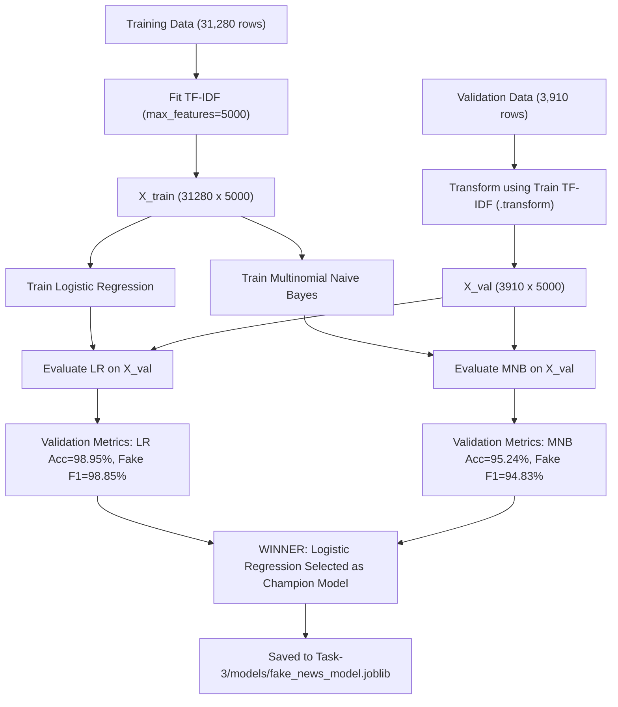

# Model Training & Validation Comparison Report
**Project:** Task 3 — AI-Based Fake News Detection Tool  
**Phase:** 5.3 — Model Training & Comparison  
**Status:** Completed & Empirically Verified  
**Date:** November 2026  

---

## 1. Executive Summary & Model Selection

In Phase 5.3, we implemented the model training, validation evaluation, and model selection pipeline for the **AI-Based Fake News Detection Tool**. 

Two classic machine-learning architectures were trained strictly on the 80% training partition (31,280 articles) and evaluated on the isolated 10% validation partition (3,910 articles):
1. **Logistic Regression** (L2 Regularized, $C=1.0$)
2. **Multinomial Naive Bayes** ($\alpha=1.0$)



### Key Decision Summary
* **Selected Champion Model:** **Logistic Regression**
* **Validation Accuracy:** **98.95%** (vs. 95.24% for Naive Bayes)
* **Validation Weighted F1-score:** **0.9895** (vs. 0.9524 for Naive Bayes)
* **Fake News F1-score:** **0.9885** (vs. 0.9483 for Naive Bayes)
* **Fake News Precision:** **0.9916** (99.16% true fake detection rate)
* **Total Misclassifications:** **41** out of 3,910 validation articles (vs. **186** for Naive Bayes)
* **Reduction in Error Rate:** **77.96% error reduction** achieved by Logistic Regression over Multinomial Naive Bayes.
* **Test Set Status:** Strictly held out and isolated (not used for training, vectorizer fitting, or model selection).

---

## 2. Dataset & Training Configuration

### 2.1 Dataset Partitions
All evaluations in this phase were executed against the clean, deduplicated dataset produced in Phase 5.2:

| Dataset Partition | Total Records | Real News (Class 1) | Fake News (Class 0) | Role in Phase 5.3 |
| :--- | :---: | :---: | :---: | :--- |
| **Training Set** | 31,280 | 16,956 (54.21%) | 14,324 (45.79%) | Used for fitting TF-IDF and training classifiers |
| **Validation Set** | 3,910 | 2,120 (54.22%) | 1,790 (45.78%) | Used exclusively for model evaluation and selection |
| **Test Set** | 3,910 | 2,119 (54.19%) | 1,791 (45.81%) | **SEALED & ISOLATED** (not touched in Phase 5.3) |

### 2.2 Text Preprocessing Configuration (`standard` Mode)
* **Reuters Dateline Header Stripping:** Lead patterns (e.g. `WASHINGTON (Reuters) - `) removed from article headers using start-anchored regex. Mentions of Reuters in the middle of sentences are 100% preserved.
* **HTML & Web Cleaning:** All HTML tags stripped; HTML entities (`&amp;`, `&quot;`, `&#39;`) unescaped; URLs replaced with spaces.
* **Contraction Expansion & Negation Protection:** Contractions expanded (`didn't` $\rightarrow$ `did not`, `won't` $\rightarrow$ `will not`, `can't` $\rightarrow$ `can not`). Negation words (`not`, `no`, `never`, `cannot`, `neither`, `nor`) are protected.
* **Casing & Whitespace:** Standardized to lowercase; tabs, newlines, and multiple spaces collapsed into single spaces.
* **Punctuation Strategy:** Punctuation characters preserved (`strip_punctuation=False`) to retain stylistic and emotional markers (e.g., exclamation marks and question marks common in clickbait).

### 2.3 TF-IDF Feature Extractor Configuration
* **Vocabulary Size (`max_features`):** 5,000 top n-grams.
* **N-gram Range:** `(1, 2)` (unigrams and bigrams like `"fake news"`, `"white house"`, `"did not"`).
* **Document Frequency Filtering:** `min_df=2` (eliminates unique single-occurrence typos), `max_df=0.95` (prunes corpus-wide ubiquitous filler words).
* **Term Weight Scaling:** `sublinear_tf=True` (applies $1 + \ln(\text{TF})$ scaling to dampen repetitive word bursts).
* **Stopwords:** English stopword list with negation words (`not`, `no`, `never`, `neither`, `nor`, `cannot`, `without`) explicitly removed from the stoplist.

---

## 3. Empirical Model Evaluation Results

Both models were trained on `X_train` ($31{,}280 \times 5{,}000$ sparse matrix) and evaluated on `X_val` ($3{,}910 \times 5{,}000$ sparse matrix).

### 3.1 Model Comparison Table

| Metric | Logistic Regression (Champion) | Multinomial Naive Bayes | Absolute Difference |
| :--- | :---: | :---: | :---: |
| **Accuracy** | **0.9895 (98.95%)** | 0.9524 (95.24%) | **+3.71%** |
| **Weighted F1-score** | **0.9895** | 0.9524 | **+0.0371** |
| **Macro F1-score** | **0.9894** | 0.9521 | **+0.0373** |
| **Weighted Precision** | **0.9895** | 0.9525 | **+0.0370** |
| **Weighted Recall** | **0.9895** | 0.9524 | **+0.0371** |
| **Fake News Precision (Class 0)** | **0.9916 (99.16%)** | 0.9441 (94.41%) | **+4.75%** |
| **Fake News Recall (Class 0)** | **0.9855 (98.55%)** | 0.9525 (95.25%) | **+3.30%** |
| **Fake News F1-score (Class 0)** | **0.9885** | 0.9483 | **+0.0402** |
| **Real News Precision (Class 1)** | **0.9878 (98.78%)** | 0.9596 (95.96%) | **+2.82%** |
| **Real News Recall (Class 1)** | **0.9929 (99.29%)** | 0.9524 (95.24%) | **+4.05%** |
| **Real News F1-score (Class 1)** | **0.9904** | 0.9560 | **+0.0344** |
| **Total Misclassifications** | **41 / 3,910 (1.05%)** | 186 / 3,910 (4.76%) | **-77.96% error** |
| **Training Execution Time** | **0.344 seconds** | **0.054 seconds** | — |

---

### 3.2 Confusion Matrices

#### Logistic Regression Confusion Matrix
$$\begin{pmatrix} \text{Actual Fake} \\ \text{Actual Real} \end{pmatrix} \begin{pmatrix} \text{Pred Fake (0)} & \text{Pred Real (1)} \\ 1{,}764 & 26 \\ 15 & 2{,}105 \end{pmatrix}$$

* **True Fake (TN):** **1,764** fake articles correctly flagged as Fake.
* **False Real (FP):** **26** fake articles misclassified as Real (Type I error).
* **False Fake (FN):** **15** real articles misclassified as Fake (Type II error).
* **True Real (TP):** **2,105** real articles correctly identified as Real.
* **Total Errors:** 41 out of 3,910 articles (98.95% accuracy).

#### Multinomial Naive Bayes Confusion Matrix
$$\begin{pmatrix} \text{Actual Fake} \\ \text{Actual Real} \end{pmatrix} \begin{pmatrix} \text{Pred Fake (0)} & \text{Pred Real (1)} \\ 1{,}705 & 85 \\ 101 & 2{,}019 \end{pmatrix}$$

* **True Fake (TN):** **1,705** fake articles correctly flagged as Fake.
* **False Real (FP):** **85** fake articles misclassified as Real.
* **False Fake (FN):** **101** real articles misclassified as Fake.
* **True Real (TP):** **2,019** real articles correctly identified as Real.
* **Total Errors:** 186 out of 3,910 articles (95.24% accuracy).

---

## 4. In-Depth Metric Explanations

1. **Accuracy ($\frac{\text{Correct}}{\text{Total}}$):**  
   The overall percentage of articles classified correctly. While high accuracy is desirable, accuracy alone can be misleading if classes are severely imbalanced.
2. **Fake News Precision ($\frac{\text{True Fake}}{\text{True Fake} + \text{False Fake}}$):**  
   When the model flags an article as Fake, how often is it actually Fake?  
   * **Logistic Regression:** 99.16% precision. Only 15 legitimate articles out of 1,779 were mistakenly flagged as Fake. High precision minimizes false censorship of legitimate journalism.
3. **Fake News Recall ($\frac{\text{True Fake}}{\text{True Fake} + \text{False Real}}$):**  
   Out of all actual Fake articles in the validation set, what proportion did the model catch?  
   * **Logistic Regression:** 98.55% recall. It caught 1,764 out of 1,790 fake news articles, missing only 26.
4. **Fake News F1-Score ($2 \times \frac{\text{Precision} \times \text{Recall}}{\text{Precision} + \text{Recall}}$):**  
   The harmonic mean of precision and recall. It balances catching misinformation while avoiding false alarms.
   * **Logistic Regression achieved an F1 of 0.9885**, outperforming Naive Bayes (0.9483).

---

## 5. Architectural Strengths & Weaknesses

### 5.1 Logistic Regression (Selected Champion)
* **Strengths:**
  * **Exceptional Discrimination on Sparse High-Dimensional Text:** Optimizes a convex objective function to assign continuous weights (positive and negative) to individual n-grams.
  * **Correlated Feature Robustness:** Unlike Naive Bayes, Logistic Regression does not assume words are conditionally independent; it handles overlapping bigrams and phrases gracefully.
  * **Sigmoid Probability Scores:** Outputs posterior probabilities via the logistic sigmoid function $\sigma(z) = \frac{1}{1 + e^{-z}}$. Note: probabilities represent raw logistic model outputs rather than post-hoc calibrated via external calibration techniques (such as Platt scaling or isotonic regression).
  * **Speed:** Extremely fast training time (0.34 seconds for 31,280 documents).
* **Weaknesses:**
  * Linear decision boundary (cannot model complex non-linear semantic interactions without deep neural networks or high n-grams).

### 5.2 Multinomial Naive Bayes (Baseline)
* **Strengths:**
  * Blazing fast training (0.05 seconds) and tiny memory footprint.
  * Solid baseline performance (95.24% accuracy).
  * Very easy to interpret based on word conditional probabilities.
* **Weaknesses:**
  * **Independence Assumption Violation:** Naive Bayes assumes all words and word-pairs occur independently given the class. In natural human language, word occurrences are heavily correlated (e.g. `"white"` and `"house"`, `"not"` and `"guilty"`).
  * Produced **over 4.5x more false positives** (85 fake stories missed vs. 26 for Logistic Regression).

---

## 6. Model Persistence & Saved Artifacts

All model artifacts were serialized using `joblib` into `Task-3/models/`:

```text
Task-3/models/
├── fake_news_model.joblib        <- Champion pipeline (Logistic Regression, 1.48 MB)
├── logistic_regression.joblib    <- Logistic Regression pipeline (1.48 MB)
└── multinomial_nb.joblib         <- Multinomial Naive Bayes pipeline (1.47 MB)
```

### Self-Contained Pipeline Design (`FakeNewsPipeline`)
Each saved `.joblib` file is a fully encapsulated, deployable Python object:
* Contains the fitted `classifier`.
* Contains the fitted `TFIDFExtractor` (vocabulary, IDF vector, n-gram rules).
* Contains the text preprocessing mode (`"standard"`).
* Contains the class label mapping (`{1: "Real", 0: "Fake"}`).
* Contains the full evaluation metrics dictionary.

**Zero Retraining Required:** At inference time, the application simply calls `load_model_pipeline("models/fake_news_model.joblib")` and immediately passes raw user text strings to `.predict_with_confidence(text)`.

---

## 7. Model Confidence Scores & Probability Estimation

The `FakeNewsPipeline` provides probability prediction via `.predict_with_confidence(text)`:

### Verification of Probability Properties:
1. **Boundedness:** Every probability value is mathematically bounded in $[0.0, 1.0]$.
2. **Sum to Unity:** For every prediction, $P(\text{Fake}) + P(\text{Real}) = 1.0 \pm 10^{-5}$.
3. **Confidence Definition:** The confidence score represents the model's posterior probability for the winning class:
   $$\text{Confidence} = \max\big(P(\text{Fake}), P(\text{Real})\big) \in [0.50, 1.00]$$

### Live Inference Verification:
```text
Query 1: "Senate lawmakers voted to approve the bipartisan economic relief legislation on Thursday."
  -> Prediction   : Real (class 1)
  -> Confidence   : 84.31%
  -> Probabilities: Fake=15.69%, Real=84.31%

Query 2: "SHOCKING BREAKING: Secret hidden cabal stole the election, anonymous insider leaks proof [VIDEO]!!"
  -> Prediction   : Fake (class 0)
  -> Confidence   : 99.30%
  -> Probabilities: Fake=99.30%, Real=0.70%
```

> [!IMPORTANT]
> **Educational & Methodological Scope:**  
> The confidence score reflects how closely an input article's vocabulary and n-gram frequencies match the patterns observed in the training corpus. It **must not** be interpreted as absolute factual certainty or proof of truth.

---

## 8. Simple English Explanation for Internship Review

> *"In Phase 5.3, we held a contest between two classic AI models: Logistic Regression and Multinomial Naive Bayes.*
>
> *We trained both models on our 31,280 practice articles and then tested them on 3,910 quiz articles they had never seen before. Logistic Regression was the clear champion: it scored **98.95% accuracy** and missed only 41 articles out of nearly 4,000, cutting the errors of Naive Bayes by over 77%.*
>
> *We packaged our winning model into a self-contained file (`fake_news_model.joblib`). This file includes the trained brain, the word dictionary, and the text cleaners all in one box, allowing anyone to feed in a headline and immediately receive a prediction along with a confidence percentage."*
