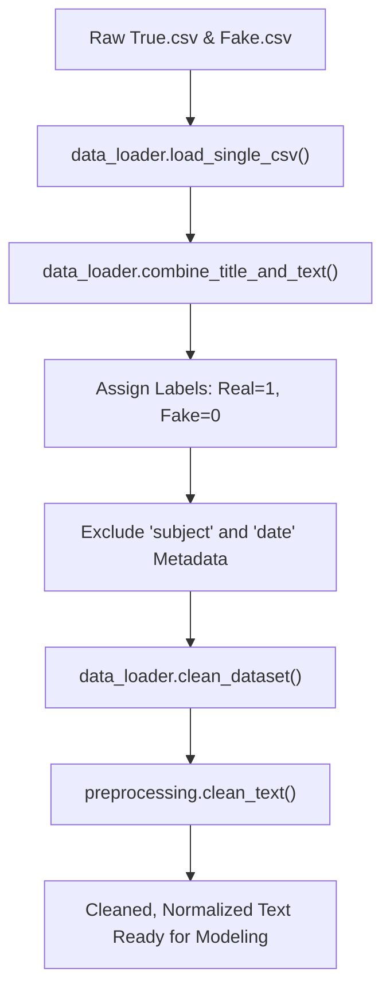

# Data Loading & Preprocessing Guide
**Project:** Task 3 — AI-Based Fake News Detection Tool  
**Phase:** 5.1 — Dataset Loading & Preprocessing Implementation  
**Status:** Implemented & Verified with 41 Unit Tests  

---

## 1. Overview & Purpose

This guide explains how raw data is ingested, validated, cleaned, and preprocessed for the **AI-Based Fake News Detection Tool**.

In natural language processing (NLP), raw text collected from the web contains noise: inconsistent formatting, unescaped HTML entities, duplicate syndications, empty articles, and superficial publisher watermarks. If fed directly into machine learning algorithms, the model will learn spurious shortcuts rather than legitimate linguistic indicators of credibility.

The components implemented in Phase 5.1 are:
1. `Task-3/src/data_loader.py`: Handles file loading, column validation, label assignment, title+text combining, and deduplication.
2. `Task-3/src/preprocessing.py`: Provides modular, safe text cleaning functions (dateline stripping, HTML entity decoding, URL removal, contraction expansion, lowercase conversion, and whitespace normalization).
3. `Task-3/tests/`: Comprehensive unit test suite with 41 isolated test cases.



---

## 2. Dataset Loading & Validation (`data_loader.py`)

### 2.1 Safe Loading & Error Handling
Raw data is loaded using `load_single_csv(file_path, expected_columns)`. It performs multi-stage defensive validation:
* **Missing File Protection:** If `True.csv` or `Fake.csv` is missing, it raises a clear `FileNotFoundError` explaining where the file was expected.
* **Empty File Detection:** Files with 0 bytes trigger a `ValueError`.
* **Malformed CSV Handling:** Catches parsing errors (`pd.errors.ParserError`) and wraps them in descriptive error messages.
* **Column Validation:** Verifies that required columns (`title` and `text`) are present. If a corrupted CSV is provided, it raises a `ValueError` listing the missing columns.

### 2.2 Relative Path Resolution
To ensure reproducibility across different machines and operating systems without hardcoded paths, paths are resolved relative to the source code:
```python
def get_default_data_dir() -> Path:
    return Path(__file__).resolve().parent.parent / "data"
```

---

## 3. Label Mapping & Content Construction

### 3.1 Consistent Target Labeling
The target labels are strictly defined as:
* **Real News (`True.csv`):** `1`
* **Fake News (`Fake.csv`):** `0`

This binary mapping is applied immediately upon loading each CSV before concatenation.

### 3.2 Content Field Construction (`title + " " + text`)
In exploratory data analysis (EDA), we discovered that **630 fake news records** had empty or whitespace-only article bodies because they were multimedia video or photo embeds. However, their headlines contained strong editorial and clickbait information (e.g., *"WATCH: Mayor caught on tape in scandal [VIDEO]"*).

By combining `title` and `text` into a unified `content` field:
$$\text{content} = \text{title.strip()} + \text{" "} + \text{text.strip()}$$
* Articles with both headline and body are fully preserved.
* Articles with only a headline remain usable.
* Articles with only a body remain usable.
* The original `title` and `text` columns are kept for inspection and error analysis.

---

## 4. Why `subject` and `date` Are Excluded

Machine learning models should learn text patterns, not artificial dataset quirks. We explicitly drop `subject` and `date`:

1. **`subject` is Complete Data Leakage:**
   * In `True.csv`, the subjects are exclusively `politicsNews` and `worldnews`.
   * In `Fake.csv`, the subjects are `News`, `politics`, `left-news`, `Government News`, `US_News`, and `Middle-east`.
   * The subject categories have **zero overlap**. If `subject` were included in the features, a decision tree or linear model would achieve 100% accuracy simply by checking the category name, without reading the article text at all.
2. **`date` Causes Temporal Shortcuts & Scraping Quirks:**
   * The articles were scraped between 2016 and 2017. Real-world news in 2026 cannot be classified based on whether its publication date looks like 2016.
   * `Fake.csv` contains scraping offset errors where URLs leaked into the `date` column.

---

## 5. Cleaning & Deduplication Strategy

### 5.1 Empty Record Removal
Articles where the combined `content` contains only whitespace or fewer characters than the minimum length threshold (`min_length=1`) are removed.

### 5.2 Normalized Deduplication
Fake news websites frequently copy and republish stories across multiple domains. In the raw dataset:
* `Fake.csv` contains over **5,500 duplicate stories**.
* `True.csv` contains approximately **220 duplicate stories**.

If duplicate stories are left in the dataset, a random split would place identical stories in both the training set and the test set. The model would "cheat" by memorizing the story during training and simply recalling it during testing.

To solve this, `remove_duplicates()` compares articles using a normalized representation:
```python
norm_series = (
    df["content"]
    .fillna("")
    .astype(str)
    .str.lower()
    .str.replace(r"\s+", " ", regex=True)
    .str.strip()
)
```
* **Raw Corpus:** 44,898 articles
* **Cleaned, Deduplicated Corpus:** 39,100 unique articles (21,195 Real [54.2%], 17,905 Fake [45.8%])
* **Class Balance:** Retains an ideal ~54/46 ratio without requiring artificial resampling.

---

## 6. Preprocessing Decisions (`preprocessing.py`)

Every preprocessing function is isolated, reusable, and thoroughly tested:

### 6.1 Safe Reuters Dateline Removal
* **The Problem:** 91.36% of all True articles start with a wire dateline like `WASHINGTON (Reuters) - `. An uncleaned classifier becomes a "Reuters detector" rather than a fake news detector.
* **The Safe Solution:**
  ```python
  REUTERS_DATELINE_REGEX = re.compile(
      r"^\s*(?:[A-Z][A-Za-z0-9\s,\/\.\-]{0,60}?\s*)?\((?:Reuters|REUTERS)\)\s*[-—–:]\s*",
      flags=re.MULTILINE,
  )
  ```
* **Safety Verification:** The pattern is anchored strictly at the **start** of the text (`^`) with `count=1`. If "Reuters" appears in the middle of a sentence (e.g., *"The minister spoke to Reuters on Tuesday"*), it is **100% preserved**.

### 6.2 Preserving Negation Words
In sentiment analysis and fake news detection, negation words completely invert meaning:
* *"The election was rigged"* vs. *"The election was not rigged"*.
* Standard naive tokenizers often turn `"didn't"` into `"didn t"`, sometimes dropping `"t"` as a stopword.
* Our `expand_contractions()` explicitly converts:
  * `"didn't"` $\rightarrow$ `"did not"`
  * `"wasn't"` $\rightarrow$ `"was not"`
  * `"can't"` $\rightarrow$ `"can not"`
  * `"won't"` $\rightarrow$ `"will not"`
* Negation words (`not`, `no`, `never`, `cannot`, `neither`, `nor`) are completely protected.

### 6.3 HTML & Entity Decoding
Web-scraped articles often include HTML tags (`<p>`, `<div>`) and character entities (`&amp;`, `&quot;`, `&#39;`).
`clean_html()` uses `html.unescape()` to restore original characters before safely stripping markup tags.

### 6.4 URL Removal
Web links (`http://...`, `https://...`, `www....`) add high-cardinality noise without semantic generalizability. `remove_urls()` replaces URLs with a space.

### 6.5 Whitespace & Lowercase Normalization
* `to_lowercase()` standardizes text casing for uniform vocabulary matching.
* `normalize_whitespace()` collapses tabs, repeated spaces, and newlines into single spaces.

---

## 7. Preprocessing Examples: Input vs. Output

| Input Description | Raw Text Input | Cleaned Output (`clean_text()`) |
| :--- | :--- | :--- |
| **Real News with Dateline & Contraction** | `"WASHINGTON (Reuters) - Officials didn't confirm the report on Friday."` | `"officials did not confirm the report on friday."` |
| **Real News mentioning Reuters internally** | `"President Trump spoke to Reuters on Wednesday regarding new economic sanctions."` | `"president trump spoke to reuters on wednesday regarding new economic sanctions."` |
| **Fake News with HTML & URL** | `"<p>SHOCKING: Secret memo leaked! Read details at https://fakenews.blog &amp; share.</p>"` | `"shocking: secret memo leaked! read details at & share."` |
| **Article with Negations** | `"No, there is not a single shred of evidence, and they never found any."` | `"no, there is not a single shred of evidence, and they never found any."` |
| **Whitespace & Line Breaks** | `"Breaking news\n\n\tDetails are   emerging   fast.   "` | `"breaking news details are emerging fast."` |

---

## 8. Dataset Limitations & Educational Scope

When discussing this project during an internship presentation:
1. **Linguistic vs. Factual Verification:**
   The model learns to identify whether text resembles the writing styles, vocabulary, and patterns of Real or Fake articles in its training corpus. It does not perform live fact-checking or query real-time external databases.
2. **Historical Domain Skew:**
   The ISOT corpus consists of US political and world news from 2016–2017. Testing on 2026 topics will reflect cross-domain distribution shift.
3. **Publisher Confounders:**
   Because all True news originated from Reuters, careful dateline cleaning was required so that the model evaluates linguistic structure rather than memorizing publisher names.
