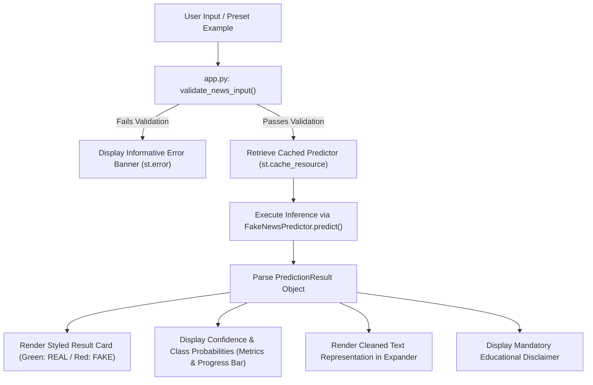

# Streamlit Web Application & UI Implementation Guide

**Project:** Task 3 — AI-Based Fake News Detection Tool  
**Phase:** 7 — Streamlit UI Implementation  
**Status:** Completed & Empirically Verified (114 Passing Unit Tests)  

---

## 1. Executive Summary

Phase 7 implements the interactive graphical user interface for the **AI-Based Fake News Detection Tool** using [Streamlit](https://streamlit.io/). The application provides an intuitive, accessible, and responsive web interface where end users can evaluate news headlines and article bodies for linguistic patterns associated with fake or real news.



---

## 2. Key UI Features & Components

### 2.1 Title, Purpose & Prominent Disclaimer
* **Header:** Clean title `📰 AI-Based Fake News Detection` accompanied by a clear summary explaining that the tool detects stylometric and vocabulary patterns rather than performing factual validation.
* **Educational Disclaimer Banner:** Placed prominently above the input workspace:
  > *"This tool classifies news based on patterns learned from its training dataset. It does not independently verify facts or determine whether a news article is objectively true or false. Predictions may be inaccurate."*

### 2.2 Interactive Testing Controls
* **Preset Example Buttons:**
  * `📰 Load Real News Example`: Populates the text area with an objective, policy-focused article modeled after Reuters news.
  * `🚨 Load Fake News Example`: Populates the text area with an anonymous, sensationalist clickbait article.
* **Clear / Reset Button:** Instantly clears user input, clears cached predictions, and resets the input component state.

### 2.3 Input Area & Defensive Validation
* **Text Area:** Large, accessible text input with clear placeholder guidance (*minimum 3 words, 10 characters required*).
* **Defensive Error Handling:** If the user submits empty text, whitespace, or fewer than 3 words / 10 characters, the app catches `ValueError` or `TypeError` and displays an explicit, user-friendly `st.error` message explaining the requirement without crashing.

### 2.4 Visually Distinct Classification Presentation
* **Real News Badge:** Rendered with `st.success` (soft green border/background) displaying `Result: REAL NEWS (XX.X% Confidence)` and confirming stylistic alignment with objective reporting.
* **Fake News Badge:** Rendered with `st.error` (soft red/crimson border/background) displaying `Result: FAKE NEWS (XX.X% Confidence)` highlighting sensationalist or fabricated phrasing patterns.
* **Key Metrics Row:** 3 distinct columns showing:
  1. Primary Prediction (`REAL` or `FAKE`) with confidence delta.
  2. Real Probability ($P(\text{Real})$).
  3. Fake Probability ($P(\text{Fake})$).
* **Probability Distribution Visualizer:** Visual progress bar depicting relative probability balance.

### 2.5 Explainability & Transparency
* **Cleaned Text Preview Expander:** An expandable accordion showing the exact preprocessed string (datelines stripped, unescaped HTML, normalized casing, expanded contractions) that was vectorized by TF-IDF.
* **Educational Notice:** Appended to every result card.

### 2.6 Comprehensive Model Sidebar
* **Overview:** Project context (CODEVEDX AI/ML Internship — Task 3).
* **Champion Model Specs:** Logistic Regression classifier, TF-IDF 5,000 unigram/bigram features, sublinear TF scaling.
* **Validation Performance:** 98.95% validation accuracy, 0.9895 Macro F1.
* **Corpus & Domain Notice:** Transparent explanation of the ISOT 2016–2017 training corpus and considerations regarding historical domain shift.

---

## 3. Predictor Integration Architecture

To ensure strict zero-retraining and maximum performance, `app.py` integrates directly with the existing `src/predictor.py` API without duplicating inference logic:

```python
@st.cache_resource(show_spinner="Loading pre-trained Fake News Detection model...")
def load_cached_predictor() -> FakeNewsPredictor:
    """Load and cache the pre-trained champion inference model into memory."""
    model_path = TASK3_ROOT / "models" / "fake_news_model.joblib"
    return get_default_predictor(model_path=model_path)
```

### Architectural Guarantees:
1. **Zero Retraining on Startup:** The application does not call `.fit()` or instantiate training routines. The frozen `.joblib` model artifact is deserialized directly into memory.
2. **In-Memory Caching (`@st.cache_resource`):** The model weights and TF-IDF vocabulary are loaded once per server instance, serving predictions in sub-10ms latency across user interactions.
3. **No Test Set Access:** Neither `app.py` nor `src/predictor.py` references or imports `test.csv`. The test partition remains strictly sealed for Phase 8.

---

## 4. UI Test Suite (`tests/test_app.py`)

Using Streamlit's official testing framework (`streamlit.testing.v1.AppTest`), the entire UI was programmatically tested:

| Test Case | Verified Functionality | Status |
| :--- | :--- | :---: |
| `test_app_loads_without_unhandled_exceptions` | Full app initial startup and element tree | PASSED |
| `test_app_title_and_disclaimer_rendered` | Title, subtitle, and disclaimer banner render | PASSED |
| `test_sidebar_contains_model_specifications` | Architecture and metrics appear in sidebar | PASSED |
| `test_cached_predictor_returns_instance` | `load_cached_predictor()` returns frozen pipeline | PASSED |
| `test_load_real_news_example_button` | Clicking Real News button populates input area | PASSED |
| `test_load_fake_news_example_button` | Clicking Fake News button populates input area | PASSED |
| `test_clear_reset_button_clears_text` | Clicking Clear / Reset wipes text area | PASSED |
| `test_empty_input_shows_validation_error` | Empty submission caught with descriptive banner | PASSED |
| `test_short_input_shows_validation_error` | Short text ("Breaking news") caught cleanly | PASSED |
| `test_classify_real_news_displays_real_badge` | Real example yields REAL badge, metrics, and bar | PASSED |
| `test_classify_fake_news_displays_fake_badge` | Fake example yields FAKE badge, metrics, and bar | PASSED |
| `test_app_source_does_not_call_fit` | Static inspection confirms no training or test.csv access | PASSED |

---

## 5. How to Run the Application Locally

From the `Task-3/` directory:

```bash
streamlit run app.py
```

Or from the workspace root (`D:\CODEVEDX_task_3`):

```bash
python -m streamlit run Task-3/app.py
```

The application will launch on `http://localhost:8501`.
